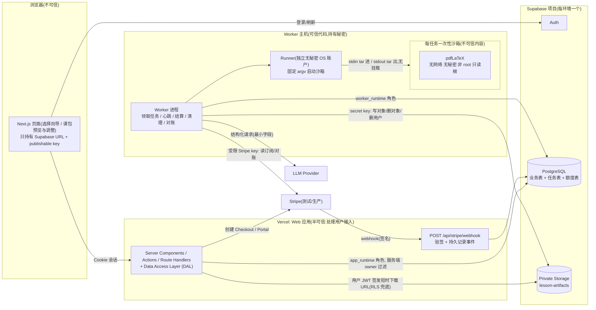
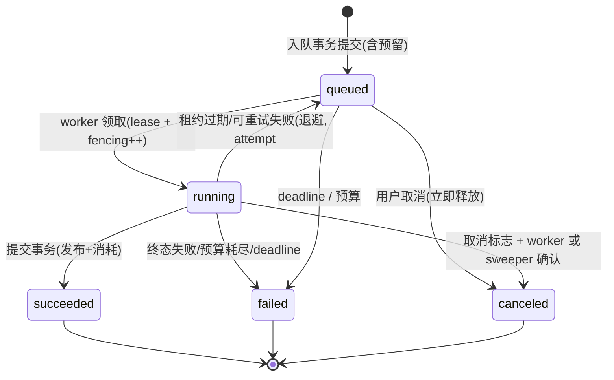
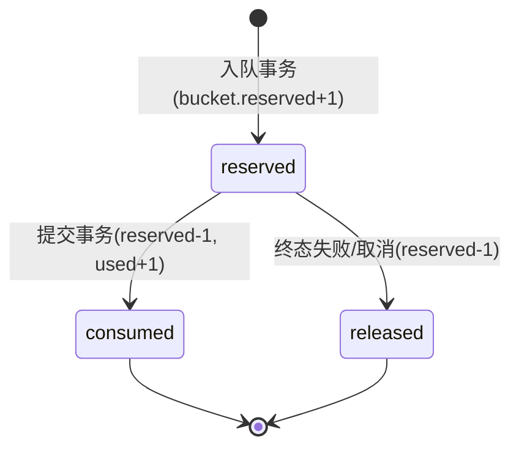
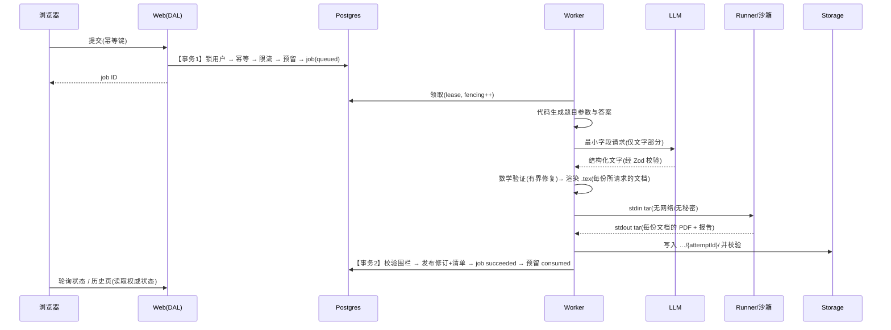
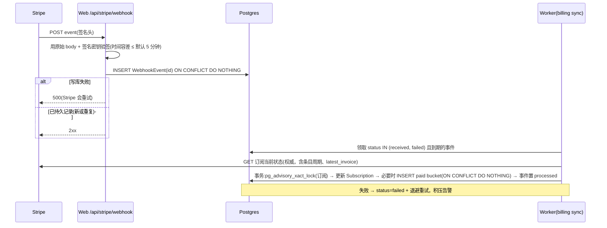

# 架构设计(Phase 0)

> 状态:设计文档,**尚无实现**。文中"待验证"表示依赖尚未用真实运行证据确认的第三方能力。版本号来自 2026-10-18 的 npm registry 查询,仅作 Phase 1 选型起点,须在 Phase 1 重新核对后固定。
> 相关:[product](product.md) · [implementation-plan](implementation-plan.md) · [test-plan](test-plan.md) · [security-and-privacy](security-and-privacy.md) · [decisions](decisions.md)
> **方向调整(2026-10-19):** 产品改为**选择优先、课程感知**(见 [product-vision](product-vision.md)、[refactor-plan](refactor-plan.md))。本文中与之冲突的部分已按新方向修订,或标注为【已被取代】。**额度、任务、幂等、围栏、权益、认证与所有权、存储与沙箱的规则不变。**

## 1. 设计原则

1. **结构化内容是事实来源**;`.tex`/PDF 是某个具体修订版本的派生物。
2. **数学由代码证明,LLM 只组织文字**:参数、答案、步骤由确定性代码产生并用精确有理数检查;LLM 只写目标、前置知识、解释、逐步说明文字、常见错误。
3. **额度是数据库事务,不是业务逻辑的副作用**:先在事务内预留,再入队;完成时在同一事务内发布 + 消耗。
4. **不承诺跨系统"恰好一次执行",只承诺"可重试执行 + 一次结算"**。
5. **Web 只入队;worker 执行;编译在每任务一次性沙箱**。沙箱无网络、无秘密。
6. **复杂度预算**:一个仓库、一个 Next.js 应用、一个 worker 入口、共享纯 TS 领域模块、Postgres 作唯一任务/额度来源。

## 2. 系统图



**秘密所在位置(这是唯一清单,新增秘密必须更新此表):**

| 位置 | 持有的秘密 / 凭据 | 明确不持有 |
|---|---|---|
| 浏览器 | `NEXT_PUBLIC_SUPABASE_URL`、publishable key、用户会话 Cookie | 其余全部 |
| Vercel Web 运行时 | `DATABASE_URL`(`app_runtime`,经事务池)、`STRIPE_SECRET_KEY`(仅创建 Checkout/Portal;优先用受限 key,待验证权限集)、`STRIPE_WEBHOOK_SECRET` | LLM key、Supabase secret key、迁移凭据 |
| GitHub Actions(受保护环境,需审批) | `MIGRATION_DATABASE_URL`(`migrator` 角色) | 运行时凭据 |
| Worker 主机 | `WORKER_DATABASE_URL`(`worker_runtime`)、`SUPABASE_SECRET_KEY`、LLM API key、Stripe 受限 key(读订阅、对账、删除账户时取消订阅) | 迁移凭据 |
| Runner 账户 | 仅容器运行时访问权限 | 任何数据库/存储/LLM/Stripe 凭据 |
| 沙箱 | 无 | 全部(无网络、无环境变量传入) |

Web 不持有 LLM key,也不持有 Supabase secret key:下载 URL 用**用户自己的 JWT** 通过 Storage RLS 签发(见 §10),删除用户等管理操作交给 worker 的删除任务。

## 3. 模块布局

单仓库、单 Next.js 应用(Phase 1 创建,此处为设计目标;不创建空抽象):

```
src/app/                 路由、Server Actions、Route Handlers(薄,仅组装)
src/components/          UI(shadcn/ui)
src/lib/domain/          纯 TS:Zod schemas、状态机、额度规则、实体类型(无 I/O)
src/lib/math/            有理数、线性方程求解/步骤检查、参数生成、验证报告(无 I/O)
src/lib/latex/           结构化内容→LaTeX 渲染、转义、模板(版本化)(无 I/O)
src/lib/llm/             provider 接口 + fake 适配器 + 一个真实适配器
src/lib/server/          server-only:认证上下文、DAL(唯一允许导入 Prisma 的地方)、
                         Storage、Stripe、速率限制
worker/                  单一入口:任务领取循环、sweeper、sandbox runner 客户端、对账
prisma/                  schema.prisma、migrations/、SQL(角色、RLS、CHECK、部分索引)
tests/                   unit / integration / e2e / latex(沙箱负面测试)
docs/
```

边界规则(用 ESLint `no-restricted-imports` + `server-only` 强制,并有测试):

- 只有 `src/lib/server/dal/**` 可导入 `@prisma/client`;所有 DAL 函数的第一个参数是 `AuthedCtx`(由服务端验证产生的品牌类型),查询必带 `ownerId`。
- `process.env` 只在 `src/lib/server/env.ts` 与 `worker/env.ts` 读取。
- `src/lib/domain|math|latex` 不得导入 Prisma、网络、文件系统。

## 4. 认证与信任链

```
浏览器 Cookie(Supabase 会话)
  → proxy.ts(Next 16;仅刷新会话,不作授权依据)
  → Server Action / Route Handler / Server Component
  → requireUser():@supabase/ssr 服务端客户端 → getClaims() 验签 JWT → userId = claims.sub
        (计费、删除账户等敏感操作改用 getUser() 向 Auth 服务端核实)
  → AuthedCtx{ userId }(品牌类型,只能由 requireUser 构造)
  → DAL 函数(ctx, ...):所有 where 带 ownerId = ctx.userId
  → Prisma(app_runtime 角色)→ Postgres
```

要点:

- **绝不**信任浏览器提供的 userId、session 对象或路由可见性;`getSession()` 不用于服务端授权。`verifyClaims` 另外要求 `role=authenticated`、非匿名、有 email,且令牌头部算法属于非对称白名单(见 security-and-privacy §9);首次创建应用账户前再用 `getUser()` 向 Auth 服务端确认邮箱已验证。
- **Prisma 直连不会继承当前 Supabase 用户的 RLS 身份**。Supabase 的 Prisma 指南让 `prisma` 角色带 `bypassrls`、`createdb`(其文档所述),本项目**不照抄**:`app_runtime`、`worker_runtime` 均无 BYPASSRLS/CREATEDB/超级用户。因此 owner 隔离的第一责任在 DAL(服务端 owner 过滤),这是显式声明的设计,而不是依赖 RLS。
- 纵深防御:所有业务表 `ENABLE ROW LEVEL SECURITY`,对 `anon`/`authenticated` **不授予任何权限**且不设策略(Data API 访问一律拒绝);对 `app_runtime`/`worker_runtime` 用显式 `TO <role> USING (true)` 策略(RLS 不用于它们的 owner 隔离)。可选加固(Phase 4 评估,不是首版承诺):事务内 `SET LOCAL app.user_id` + owner 策略。
- Server Action 视为可被直接 POST:每个 action 内重新 `requireUser()`、校验输入(Zod)、校验资源归属(IDOR)、只返回 DTO。Origin/Host 校验保持 Next 默认,生产配置 `allowedOrigins` 前先核对实际域名。
- 私有页面与 API:动态渲染,响应 `Cache-Control: private, no-store`;避免带 `Set-Cookie` 的响应被缓存(Supabase 文档警告)。

## 5. 数据模型

下表只列关键字段、约束与索引;完整 Prisma schema 在 Phase 1 编写。时间一律 UTC(`timestamptz`);成本用整数微单位(`*_micros`,**内部成本核算单位**,不是向客户计费金额;Stripe 金额不入本地库,仅保留价格 ID)。

### 5.1 表

| 表 | 关键字段 | 约束 / 索引 |
|---|---|---|
| **Profile** | `id`(=Supabase auth uid, PK)、`status`(active/deleting)、`stripeCustomerId?`、`createdAt` | `stripeCustomerId` 唯一(部分,非空)。仅在邮箱已验证后由 `ensureProfile` 幂等创建(`ON CONFLICT DO NOTHING`)。 |
| **Lesson** | `id`、`ownerId`→Profile、`title`、`inputSpec` jsonb(经 Zod)、`currentRevisionId?`、`deletedAt?` | 索引 `(ownerId, createdAt desc) WHERE deletedAt IS NULL` |
| **LessonRevision** | `id`、`lessonId`、`ownerId`、`number`、`status`(draft/finalized/rejected)、`schemaVersion`、`content` jsonb、`contentHash`、`validationReport` jsonb、`validationStatus`(verified/failed/unverified)、`acknowledgement?` jsonb、`sourceRevisionId?`、`templateVersion`、`validatorVersion`、`generationMeta` jsonb、`artifactManifest?` jsonb、`createdByJobId?` | 唯一 `(lessonId, number)`;`ownerId` 必须等于所属 lesson 的 `ownerId`(复合外键 `(lessonId, ownerId)`);finalized 后 `content`/`contentHash` 不可变(触发器);`artifactManifest` 写一次(`WHERE artifactManifest IS NULL`) |
| **GenerationJob** | `id`、`ownerId`、`kind`(generate/compile)、`state`、`stage?`、`lessonId`、`revisionId?`、`requestHash`、`attempt`、`maxAttempts`、`runAfter`、`leaseOwner?`、`leaseExpiresAt?`、`fencingToken` bigint、`cancelRequestedAt?`、`deadlineAt`、预算:`callsUsed/maxCalls`、`tokensUsed/maxTokens`、`costMicros/maxCostMicros`、`errorCode?`、`createdAt/startedAt/finishedAt` | 索引 `(runAfter) WHERE state='queued'`;`(leaseExpiresAt) WHERE state='running'`;`(ownerId, state)`;`(ownerId, createdAt desc)`;CHECK 状态与字段一致性(running 必有 lease) |
| **IdempotencyKey** | `ownerId`、`operation`、`key`、`requestHash`、`resourceType`、`resourceId`、`createdAt` | **PK `(ownerId, operation, key)`** |
| **UsageBucket** | `id`、`ownerId`、`kind`(trial/paid)、`limit`、`used`、`reserved`、`startsAt`、`endsAt?`、`subscriptionId?`、`periodKey?` | CHECK `used>=0 AND reserved>=0 AND used+reserved<=limit`;**唯一部分索引 `(ownerId) WHERE kind='trial'`**;**唯一 `(subscriptionId, periodKey)`**(paid;`periodKey`=已验证订阅条目的周期开始时间,epoch 秒) |
| **UsageReservation** | `id`、`ownerId`、`bucketId`、`jobId`、`state`(reserved/consumed/released)、`settleReason?`、`reservedAt`、`settledAt?` | **`jobId` 唯一**(每任务至多一次消耗记录);状态迁移只通过 `UPDATE … WHERE state='reserved'` |
| **Subscription** | `id`、`ownerId`、`stripeSubscriptionId`、`stripePriceId`、`status`(原样存 Stripe 状态字符串)、`cancelAtPeriodEnd`、`periodStart/periodEnd`(取自订阅条目)、`latestInvoicePaid`、`syncedAt` | 唯一 `stripeSubscriptionId`;**部分唯一 `(ownerId) WHERE status IN ('active','past_due','unpaid','incomplete','paused')`**(一个账户同一时刻一个"活动态"订阅,与 Stripe 侧 Checkout 竞态一起处理,见 §9);`canceled` 为终态,不得转回 |
| **WebhookEvent** | `id`(=Stripe event id,PK)、`type`、`objectId`、`livemode`、`stripeCreated`、`receivedAt`、`status`(received/processing/processed/failed)、`attempts`、`nextAttemptAt`、`lastErrorCode?`、`processedAt?` | **不存完整 payload**,只存处理与排障所需字段。索引 `(status, nextAttemptAt)` |
| **RateLimitWindow** | `key`(如 `gen:u:<id>`、`gen:ip:<hash>`)、`windowStart`、`count` | PK `(key, windowStart)`;`INSERT … ON CONFLICT DO UPDATE SET count=count+1` |
| **TrialTombstone**(待决策 D-08) | `emailHmac`、`createdAt` | 唯一 `emailHmac`;删除账户后保留以防止重新注册重置试用额度。需披露保留目的。 |

`Subscription` 与 `Profile.stripeCustomerId` 共同承担"billing customer mapping":客户 ID 永远从已验证的 owner 解析,从不接受客户端传入。

### 5.3 Drafts (slice S1 of the preview-first flow; D-102 to D-108, [plan](superpowers/plans/2026-10-23-preview-adjust-export.md))

Two additive tables, independent of `lesson`, `lesson_revision`, the job queue and the allowance:

| Table | Holds | Guarded by |
|---|---|---|
| `draft` | the validated request, the curriculum context snapshot (stored once), `rev`, `active_version_id`, `version_count`, `status` (`active`/`expired`), `expires_at` | trigger: owner, request, request hash and context are immutable; status only moves `active` -> `expired`; unique `(id, owner_id)`; partial indexes on `expires_at` for live and for expired rows |
| `draft_version` | one verified package (stored without the request and context, which live on the draft), `content_hash`, `question_meta`, `next_question_seq`, undo `history`, `changes`, `pending_candidate` | composite FK `(draft_id, owner_id)` with cascade; trigger: identity is immutable and every update must set `rev = rev + 1` (optimistic concurrency); unique `(draft_id, ordinal)` |

`app_runtime` can read, insert and update but never delete; `worker_runtime` can read, update and delete, and purges drafts in the sweep loop: first it marks drafts past `expires_at` as expired, then deletes the ones past `expires_at + grace` (batches with `FOR UPDATE SKIP LOCKED`). Versions cascade.

With `FLOW_MODE=draft` the Prepare action calls `createDraft`: one transaction that locks the profile, applies the idempotency key (operation `draft`), checks the limits (`rate_limit_window` keys `draft:u:`, `draft:ip:`, `draft:global`, plus the active-draft cap), builds the package with a random server-side seed, runs `validatePackage` (only `verified` is stored) and inserts the draft and version 1. It never touches `usage_bucket`, `usage_reservation` or `generation_job` (a test pins that). `/drafts/[id]` renders the HTML preview server-side; the package itself is never sent to client components. With the default `FLOW_MODE=legacy` nothing changes. Every threshold (rates, caps, TTL default 14 days, purge grace and batch) is configuration in `src/lib/server/limits.ts`; the defaults are placeholders for the owner to tune. Export from drafts arrives in later slices.

Operational notes:
- An unset `FLOW_MODE` means `legacy`. A blank or invalid `FLOW_MODE`, or an invalid `DRAFT_*` / limit value, makes `serverEnv()` throw on every request, including the legacy flow (fail fast at configuration time, not at first use).
- The per-IP draft limit is dormant: `createDraft` supports a hashed address, but no IP-hash helper exists yet (the same is true of legacy generation), so only the per-user and global limits are active.
- The `draft:global` counter row is locked from the first increment until commit, so concurrent draft creations queue briefly on it; the per-account profile lock is always taken first (a documented lock-order contract in `createDraft`).
- The database also freezes expired drafts: the expiry of an expired or past-due draft cannot be changed, `draft.rev` moves by exactly one, and versions of an expired draft cannot be updated (migration `draft_guard_hardening`).


**Question-level adjustment (slice S2).** `src/lib/package/draft-ops.ts` holds the pure operations; the DAL runs each one in a transaction that locks the version row, compares `expectedRev` (else `DRAFT_CONFLICT` with the current rev), and writes with `rev = rev + 1`. Candidate requests, try another and keep original change only `pending_candidate` (one per version: `{id, targetQuestionId, baseRev, baseHash, item, attempt, tried[]}`), never `content`. Accept re-verifies the stored item, requires `baseHash` to equal the current content hash (else `CANDIDATE_STALE`), swaps the exercise and its solution at the same position and level under a new id `ex-{next_question_seq}`, rehashes and requires `validatePackage` to be `verified`. Remove keeps ids stable (numbering is positional at render) and respects the minimum. Undo restores the before-image of the exercises and solutions sections, `question_meta` and `changes` from the bounded `history` stack, keeps `next_question_seq`, and asserts the restored content hash equals the recorded `beforeHash`. Remove, accept and undo drop a pending candidate (it was drawn against other content). Drafts never append to `pkg.adjustments[]`.
### 5.2 按用户隔离的数据访问规则

1. 所有 DAL 读写函数签名 `(ctx: AuthedCtx, …)`;`where` 必含 `ownerId: ctx.userId`;通过 id 取资源用 `findFirst({ where: { id, ownerId } })`,找不到统一返回 404(不区分"不存在"与"无权限")。
2. 子资源(revision、job、artifact、reservation)自身带 `ownerId`,且复合外键保证与父资源 owner 一致;下载/取消/轮询均走同一规则。
3. 自动化测试遍历 DAL 导出函数,对"用户 A 的资源 + 用户 B 的上下文"断言全部拒绝(见 [test-plan](test-plan.md) §5)。
4. 运行时角色权限:
   - `app_runtime`:业务表 SELECT/INSERT/UPDATE(按需列级),**无 DELETE 于 UsageBucket/UsageReservation/WebhookEvent**;无 DDL。
   - `worker_runtime`:GenerationJob、LessonRevision、UsageBucket、UsageReservation、Lesson(状态)、WebhookEvent、Subscription、清理相关表的必要 DML;无 DDL;无权访问 Auth schema。
   - `migrator`:仅迁移流程使用,不出现在 Web/worker 运行环境。
   - 三者均不得有 BYPASSRLS/CREATEDB/SUPERUSER;`anon`/`authenticated` 对业务表无任何授权。
5. Web 的 Vercel 函数使用**事务池**连接串(Supabase:端口 6543 + `pgbouncer=true`),worker 使用会话池/直连;迁移使用直连/会话池。Prisma 版本与池化参数的组合在 Phase 1 逐一实测(Prisma `latest` 标签目前指向 8.0.0-rc,稳定线为 7.10.1;**首版固定稳定版**,不使用 RC)。

## 6. 额度、任务与故障

### 6.1 状态机

任务(终态用于结算;阶段只表示进度):



`running` 内的阶段:`generating → validating → compiling → storing`(修复循环在 generating/validating 之间,有次数上限)。

预留:



没有任何其他迁移;`consumed`/`released` 之后再次尝试迁移的 `UPDATE … WHERE state='reserved'` 影响 0 行,调用方回滚。

生成数据流(持久化点与事务边界):



### 6.2 创建生成(预留 + 入队 + 幂等,一个事务)

```ts
// createGeneration(ctx, input, idempotencyKey)  -- 在 DAL 内
const spec = GenerateInput.parse(input);               // 长度/题量/枚举上限
const requestHash = sha256(canonicalJson({ op: 'generate', spec, v: 1 }));

return retryable(3, ['40001', '40P01'], () => tx(async (t) => {   // READ COMMITTED + 显式锁;冲突类错误整体重试
  // 0. 串行化同一用户的所有入队(用户级互斥点)
  await t.q`SELECT 1 FROM profile WHERE id=${ctx.userId} AND status='active' FOR UPDATE`;

  // 1. 幂等
  const ins = await t.q`INSERT INTO idempotency_key(owner_id,operation,key,request_hash)
                        VALUES (${ctx.userId},'generate',${key},${requestHash})
                        ON CONFLICT DO NOTHING RETURNING 1`;
  if (!ins.length) {
    const prev = await t.q`SELECT request_hash, resource_id FROM idempotency_key
                           WHERE owner_id=${ctx.userId} AND operation='generate' AND key=${key}`;
    if (prev.request_hash !== requestHash) throw Conflict('IDEMPOTENCY_KEY_REUSED');   // 409
    return getJob(t, ctx, prev.resource_id);                                           // 原 job
  }

  // 2. 速率与并发(持久,见 §6.6)
  await enforceRateLimit(t, ctx.userId, ipHash);                 // 计数不退还
  await assertActiveJobs(t, ctx.userId, { max: cfg.maxActivePerUser });
  await assertGlobalBacklog(t, { max: cfg.maxQueuedGlobal });

  // 3. 选 bucket(来源在此固定)
  const sub = await activeEntitlement(t, ctx.userId, now);       // status=active 且 now∈[periodStart,periodEnd) 且已付
  const bucket = sub ? await lockPaidBucket(t, sub, now)         // SELECT … FOR UPDATE
                     : await lockTrialBucket(t, ctx.userId);
  // 4. 条件更新是最终裁判;CHECK 约束是兜底
  const ok = await t.q`UPDATE usage_bucket SET reserved=reserved+1
                       WHERE id=${bucket.id} AND used+reserved<limit RETURNING id`;
  if (!ok.length) throw AllowanceExhausted({ pending: bucket.reserved });   // 整个事务回滚,幂等记录也不留

  // 5. 任务 + 预留 + 回填幂等记录
  const job = await t.q`INSERT INTO generation_job(...state='queued', deadline_at=${now+cfg.jobDeadline}, budgets...)`;
  await t.q`INSERT INTO usage_reservation(owner_id,bucket_id,job_id,state) VALUES (…,'reserved')`;
  await t.q`UPDATE idempotency_key SET resource_type='job', resource_id=${job.id} WHERE …`;
  return job;
}));
```

- **同键同请求**:唯一键冲突后读到原记录,哈希一致 → 返回原 job。**同键不同请求** → 409。
- **额度不足的请求不留幂等记录**:重试会重新评估(例如前一个任务失败释放了额度)。
- 用户级 `FOR UPDATE` 使同一用户的并发入队串行;同时 `UPDATE … WHERE used+reserved<limit` 与 CHECK 约束是不依赖锁的双重保险。全局竞争不需要锁(不同用户不共享 bucket)。

### 6.3 具体例子:已完成 2 次,同时提交两个新任务

初始 `trial: limit=3, used=2, reserved=0`。请求 A、B 带不同幂等键同时到达:

1. A、B 同时尝试锁 Profile 行;A 先得到,B 等待。
2. A:`UPDATE … WHERE used+reserved<limit` → `2+0<3` 成立 → `reserved=1`,插入 job_A 与 reservation_A,提交。
3. B 获得锁后:`2+1<3` 不成立 → 0 行 → 抛 `AllowanceExhausted(pending=1)`,事务回滚。B 的用户看到"额度不足;有 1 个进行中的任务,若其失败额度会返还"。
4. 若 job_A 之后成功:`used=3, reserved=0`,B 重试仍被拒。若 job_A 失败:reservation_A → released,`reserved=0`,B 重试可成功。

**同一请求重试**:A 的客户端因超时用同一幂等键、同一请求体重发 → 命中 `idempotency_key` 主键冲突 → 哈希一致 → 返回 job_A;`reserved` 不变(不会变成 2)。

### 6.4 领取、心跳、围栏

```sql
-- claim:跳过已被锁的行,不持有跨 LLM/编译的长事务
UPDATE generation_job SET state='running', stage='generating',
       lease_owner=$worker, lease_expires_at=now()+$lease,
       fencing_token=fencing_token+1, attempt=attempt+1,
       started_at=COALESCE(started_at,now())
WHERE id = (SELECT id FROM generation_job
            WHERE state='queued' AND run_after<=now()
            ORDER BY created_at FOR UPDATE SKIP LOCKED LIMIT 1)
RETURNING *;   -- 返回 id、fencing_token 给 worker

-- heartbeat(每 lease/3):0 行 = 失去租约或被取消 → 立即中止(杀沙箱进程组)
UPDATE generation_job SET lease_expires_at=now()+$lease
WHERE id=$id AND fencing_token=$token AND state='running' AND cancel_requested_at IS NULL;
```

- 每次领取 `fencing_token` 递增;之后所有对该任务的写入都带 `(id, fencing_token)`。
- 预算计数(调用次数、token、成本、阶段)也用 `WHERE fencing_token=$token` 更新,过期 worker 写不进去。
- **总预算**:`maxCalls / maxTokens / maxCostMicros / deadlineAt` 是整个任务(含所有重试)共享的;重试不重置。`attempt` 上限 `maxAttempts`(配置,默认值待定)。
- 重试仅对可恢复错误(超时、限流、5xx、租约过期);退避 `min(cap, base·2^attempt) × jitter`,写入 `run_after`。数学失败、模式不合法、编译确定性失败**不重试**(至多一次受限的"修复"调用,见 §7.4)。

### 6.5 完成与释放(结算)

```ts
// commitSuccess(job, token, attemptId, artifacts, revisionDraft)  —— worker 调用,事务很短
tx(async (t) => {
  const j = await t.q`SELECT * FROM generation_job WHERE id=${job.id} FOR UPDATE`;
  if (j.state!=='running' || j.fencing_token!==token || j.cancel_requested_at) throw StaleOrCanceled();
  if (await lessonDeleted(t, j.lesson_id)) throw StaleOrCanceled();             // 删除后不得发布
  assertManifestComplete(artifacts, attemptPrefix(j, attemptId));                // 所请求文档的全部文件,sha256+大小,路径前缀属于本 attempt
  const rev = await insertFinalizedRevision(t, revisionDraft, artifacts);        // 内容 + 验证报告 + 清单
  await t.q`UPDATE lesson SET current_revision_id=${rev.id} WHERE id=${j.lesson_id}`;
  const r = await t.q`UPDATE usage_reservation SET state='consumed', settled_at=now()
                      WHERE job_id=${j.id} AND state='reserved' RETURNING bucket_id`;
  if (!r.length) throw InvariantViolation();                                     // 回滚;告警
  await t.q`UPDATE usage_bucket SET reserved=reserved-1, used=used+1 WHERE id=${r[0].bucket_id}`;
  await t.q`UPDATE generation_job SET state='succeeded', stage=NULL, revision_id=${rev.id}, finished_at=now() WHERE id=${j.id}`;
});

// releaseFailure(job, token|sweeper, reason)  —— 同样只在 WHERE state='reserved' 时生效
tx(async (t) => {
  /* 锁 job;若已终态则幂等返回 */
  const r = await t.q`UPDATE usage_reservation SET state='released', settle_reason=${reason}, settled_at=now()
                      WHERE job_id=${j.id} AND state='reserved' RETURNING bucket_id`;
  if (r.length) await t.q`UPDATE usage_bucket SET reserved=reserved-1 WHERE id=${r[0].bucket_id}`;
  await t.q`UPDATE generation_job SET state=${'failed'|'canceled'}, error_code=${reason}, finished_at=now() WHERE id=${j.id}`;
});
```

- 成功事实 = 同一事务内的 **revision 发布 + 清单 + job succeeded + 预留 consumed**。清单(版本化,`manifestVersion`)必须包含**所请求文档**(Notes、Worksheet、Solutions;完整包三份)各自的 `.pdf` 及内部 `.tex`;**任一缺失 → `assertManifestComplete` 失败 → 不提交,走失败路径并释放预留**。(2026-10-19:原为学生版/教师版 4 个文件;旧清单对旧修订继续有效。)
- `commitSuccess` 对"同一 attempt 已成功"幂等返回(处理提交后响应丢失的重试)。
- 对象存储与数据库不共享事务:先把对象写入 `…/{attemptId}/` 前缀并校验(HEAD + sha256),再提交清单(见 §10)。

### 6.6 故障矩阵

| 故障 | 发生时的状态 | 恢复与结果 | 额度 |
|---|---|---|---|
| 模型超时/限流/5xx | running/generating | 在预算内退避重试;耗尽 → `failed(llm_*)` | released |
| 数学验证不通过 | running/validating | 至多 N 次有界修复(重新生成说明文字,**不**改数字);仍失败 → 保存 `rejected` 草稿供查看,`failed(validation_failed)` | released |
| 编译失败(确定性) | running/compiling | 不重试(沙箱/基础设施类错误至多重试一次);`failed(compile_failed)`,返回脱敏的可操作信息 | released |
| 上传中断 | running/storing | 重试使用新的 attemptId 前缀;耗尽 → `failed(storage_failed)`;失败的尝试会尽力删除自己的前缀;崩溃留下的残留对象需要定期对账(P3,尚未实现) | released |
| 上传成功但 DB 提交失败 | 事务回滚,对象孤立 | worker 对提交做有界重试(幂等);仍失败或崩溃 → 租约过期 → 重新排队、新 attempt 重做;失败的尝试会尽力删除自己的前缀(提交被明确拒绝时);崩溃留下的孤立对象需要定期对账(P3,尚未实现) | 仍 reserved,直到成功或终态失败 |
| DB 已提交但浏览器没收到响应 | succeeded 已成事实 | 页面刷新/轮询/历史页读取权威状态;幂等 POST 重放返回原 job | consumed(一次) |
| worker 重启/崩溃 | running,租约不再续 | sweeper:`lease_expires_at<now()` 的 running 任务 → queued(attempt<max 且预算未尽)或 failed;启动时杀掉带 `noteprep-job` 标签的残留沙箱 | 沿用原预留 |
| 旧 worker 晚到成功 | job 已 requeued/failed/canceled 或 token 已变 | `commitSuccess` 的 token/state 检查失败 → 回滚;其对象成为孤儿被清理;**不会再次消耗** | 不变 |
| 取消 | queued:立即 canceled + released;running:置 `cancel_requested_at`,心跳发现后中止 | 提交时再次检查取消标志;worker 死亡则 sweeper 终结 | released |
| 删除课包/账户(在途) | Lesson/Profile 先置删除态 | 提交前检查删除态;在途任务被取消并释放;之后才清理对象与记录;恢复流程不得"复活"已删除内容 | released |

**"失败返还"为何不会造成无限免费计算:**

1. 速率限制计数在**入队时**增加且**不因失败退还**(账户与 IP 两个维度,持久化于 `RateLimitWindow`)。
2. 每账户同时在途任务数上限(配置)。
3. 每任务硬预算(调用/token/成本/时长/重试),已消耗的成本写入 job 行,失败也计入。
4. **每账户 24 小时滚动成本上限**:入队时 `SUM(cost_micros)`(含失败任务)超限则拒绝(与额度无关)。
5. 连续失败熔断:同一账户连续 K 次终态失败后冷却 T(配置)。
6. 全局日成本上限作为总开关(超限暂停入队,告警)。
7. 以上阈值的具体数值**待定**(配置项,上线前根据真实成本数据确定)。

### 6.7 Sweeper / 对账循环(在 worker 进程内)

间隔执行、均有行锁或租约防并发:过期租约回收;取消与 deadline 终结;孤立对象清理(超过宽限期且未被任何已提交清单引用的前缀);已删除课包/账户的物化清理;WebhookEvent 重试;Stripe 订阅对账;**不变量检查**(`bucket.reserved = count(reservation reserved)`,`bucket.used = count(consumed)`,不一致则告警、不自动修复)。

### 6.8 试用/付费 bucket 与订阅变化

- **试用 bucket**:每账户一个,`limit=3`,终身,仅由 `ensureProfile` 事务创建(部分唯一索引使重复回调无效)。
- **付费 bucket**:订阅同步在**已验证 Stripe 状态**下为 `(subscriptionId, periodKey)` `INSERT … ON CONFLICT DO NOTHING`,`limit` 取配置值(测试值须标注 `TEST VALUE`)。
- **选择规则**:存在有效权益(§9)→ 只用当前周期的 paid bucket;否则用 trial。来源在入队事务内确定并写入 reservation,之后不变。
- **跨周期在途任务**:预留只在周期有效时创建;已预留任务在周期结束后仍对原 bucket 结算,**不借用**下一周期额度。
- **订阅中途失效**(past_due/unpaid/canceled…):不再创建新的付费预留;在途已预留任务完成;trial 剩余次数重新成为可用来源。
- **历史成果**:不受订阅状态影响,可查看/编辑/重新编译/下载(重新编译受计算配额限制)。

## 7. 内容与数学

### 7.1 事实来源与派生物

| 层 | 内容 | 性质 |
|---|---|---|
| `LessonRevision.content`(JSON,`schemaVersion`) | 目标、前置知识、时间安排、解释、例题、练习(仅题面)、答案册(单独数组)、常见错误 | **事实来源** |
| `validationReport` | 逐题验证项(方法、覆盖、结果、限制、validatorVersion、被验证内容的哈希) | 事实,依附于具体内容哈希 |
| `.tex`(内部)与 `.pdf`,每份所请求的文档一对 | 由某个 revisionId + templateVersion 确定性渲染/编译而来 | **派生物**,清单记录 sha256;任何内容变化 → 新修订;`.tex` 不提供给用户 |

练习题面与答案分列:`exercises[]` 不含答案;`answerKey[]` 以 `questionId` 关联。(2026-10-19:"学生版/教师版"现为 Worksheet / Notes + Solutions 三份文档,同样的类型层面隔离适用于 Worksheet。)Worksheet(原学生版)渲染函数的输入类型**不包含** `answerKey`(类型层面隔离),并在 worker 里对编译后的学生版 PDF 文本做"不含答案串"检查(见 test-plan)。例题(`workedExamples`)带完整解答,两个版本都保留。

### 7.2 一元一次方程的结构与示例

表示法:有理数一律字符串 `"p"` 或 `"p/q"`(BigInt 精确运算,不使用浮点)。一侧表达式 `{x:[系数…], c:[常数…]}` 表示 `(Σx系数)·x + Σ常数`,允许未合并形式,验证时精确求和比较。

**支持的子集(首版,Type A/B):** `ax + b = c`、`ax + b = cx + d`;`a,b,c,d` 为整数或简单分数(分子/分母有范围上限);单变量 `x`;结果种类 `unique | no_solution | identity`。允许的步骤操作:`add_const_both_sides`、`add_x_term_both_sides`、`multiply_both_sides`(非零)、`divide_both_sides`(非零)。**不支持(验证器返回 `unsupported`,不会被标为 verified):** 括号/分配律(列为紧随其后的扩展,通过验证覆盖后才开放)、变量在分母、不等式、含文字情境的建模题、任何未在语法中的表达式。没有 eval、没有 `new Function`、没有通用 CAS、不执行模型生成的代码。

下面是一个**人工可核对的示意**(`contentHash` 为占位符,真实值由代码计算)。**说明(2026-10-19):** 这里展示的是**数学题目部分**的结构,仍然有效且已实现于 `src/lib/math`;整体课包的顶层结构(分节、依赖、逐节哈希、三份文档)由 `lesson-package/1` 取代这里的 `lesson-content/1`,见 [refactor-plan](refactor-plan.md) §3.3。

```json
{
  "schemaVersion": "lesson-content/1",
  "meta": { "topic": "Linear equations in one variable", "level": "Grade 7-8 equivalent (assumption)",
            "language": "en", "durationMinutes": 60, "difficulty": "mixed", "curriculum": null },
  "objectives": [ { "id": "obj-1", "text": "Solve equations of the form ax + b = c and ax + b = cx + d." } ],
  "workedExamples": [ {
    "id": "we-1",
    "problem": { "type": "linear_one_var", "form": "ax+b=c", "params": { "a": "3", "b": "5", "c": "20" },
                 "equation": { "lhs": { "x": ["3"], "c": ["5"] }, "rhs": { "x": [], "c": ["20"] } } },
    "solution": { "kind": "unique", "value": "5" },
    "steps": [
      { "id": "we-1.s1", "op": { "type": "add_const_both_sides", "value": "-5" },
        "result": { "lhs": { "x": ["3"], "c": [] }, "rhs": { "x": [], "c": ["15"] } } },
      { "id": "we-1.s2", "op": { "type": "divide_both_sides", "value": "3" },
        "result": { "lhs": { "x": ["1"], "c": [] }, "rhs": { "x": [], "c": ["5"] } } }
    ]
  } ],
  "exercises": [
    { "id": "ex-1", "difficulty": "basic",
      "problem": { "type": "linear_one_var", "form": "ax+b=cx+d", "params": { "a": "2", "b": "-7", "c": "5", "d": "8" },
                   "equation": { "lhs": { "x": ["2"], "c": ["-7"] }, "rhs": { "x": ["5"], "c": ["8"] } } } },
    { "id": "ex-2", "difficulty": "challenge",
      "problem": { "type": "linear_one_var", "form": "ax+b=cx+d", "params": { "a": "4", "b": "6", "c": "4", "d": "-2" },
                   "equation": { "lhs": { "x": ["4"], "c": ["6"] }, "rhs": { "x": ["4"], "c": ["-2"] } } } }
  ],
  "answerKey": [
    { "questionId": "ex-1", "solution": { "kind": "unique", "value": "-5" },
      "steps": [
        { "id": "ex-1.s1", "op": { "type": "add_x_term_both_sides", "value": "-5" },
          "result": { "lhs": { "x": ["-3"], "c": ["-7"] }, "rhs": { "x": [], "c": ["8"] } } },
        { "id": "ex-1.s2", "op": { "type": "add_const_both_sides", "value": "7" },
          "result": { "lhs": { "x": ["-3"], "c": [] }, "rhs": { "x": [], "c": ["15"] } } },
        { "id": "ex-1.s3", "op": { "type": "divide_both_sides", "value": "-3" },
          "result": { "lhs": { "x": ["1"], "c": [] }, "rhs": { "x": [], "c": ["-5"] } } }
      ] },
    { "questionId": "ex-2", "solution": { "kind": "no_solution" },
      "steps": [
        { "id": "ex-2.s1", "op": { "type": "add_x_term_both_sides", "value": "-4" },
          "result": { "lhs": { "x": ["0"], "c": ["6"] }, "rhs": { "x": [], "c": ["-2"] } } }
      ] }
  ],
  "narrations": { "we-1.s1": "Subtract 5 from both sides to isolate the x term.", "...": "plain text, LLM-written" },
  "commonMistakes": [ { "id": "cm-1", "text": "Forgetting to apply the same operation to both sides.", "relatedQuestionIds": ["we-1", "ex-1"] } ],
  "validationReport": {
    "validatorVersion": "linear-1var/0.1",
    "overall": "verified",
    "items": [ { "questionId": "ex-1", "contentHash": "sha256:<computed>", "status": "verified",
                 "checks": ["params_domain", "exact_solve:x=-5", "substitution:-17=-17", "step_equivalence:3/3", "answer_key_match"],
                 "limitations": ["narration text not validated"] } ]
  }
}
```

人工核对(可逐项心算):

- `we-1`:3x+5=20 → 两边减 5 → 3x=15 → 除以 3 → x=5;代回 3·5+5=20 ✓。
- `ex-1`:2x−7=5x+8 → 两边加 −5x → (2−5)x−7=8,即 −3x−7=8 → 两边加 7 → −3x=15 → 除以 −3 → x=−5;代回左 2(−5)−7=−17,右 5(−5)+8=−17 ✓。
- `ex-2`:4x+6=4x−2 → 两边加 −4x → 0·x+6=−2,即 6=−2 恒假 → 无解(`a−c=0` 且 `b≠d`)✓。

示例中 `"..."` 与占位哈希只为缩短篇幅,不是有效数据;`narrations` 的文字是 LLM 产物,**数字和公式不得出现在叙述文字里**(叙述中涉及的数学只能引用结构化步骤 ID,由渲染器插入),验证器对此类文本报告"未验证"。

### 7.3 验证器做什么(逐项独立检查)

对每道例题/练习,代码依次检查并写入 `validationReport`:

1. **参数域**:参数在难度对应的范围内;`form` 与 `equation` 一致;不产生被排除的退化情形(除非本题类型就是 no_solution/identity)。`equation` 必须等于由 `params` 重新推导的结果(防止题面与参数不一致)。
2. **独立精确求解**:由原方程直接求出 `unique(x)` / `no_solution` / `identity`(比较系数:`a−c`, `d−b`)。
3. **代回**:唯一解代回原方程两侧,精确相等。
4. **逐步等价**:对每一步,用声明的 `op` 从前一状态**重新计算**期望状态并与 `result` 精确比较;乘除数不得为 0;并确认每步前后解集相同(同一唯一解/同一无解)。末步必须是 `x = 解` 或矛盾式/恒等式。
5. **题答对应**:`exercises[].id` 与 `answerKey[].questionId` 一一对应;答案册的 `solution` 与第 2 步的独立结果一致。
6. **定义域与特殊情形**:v1 无变量分母,因此不存在增根;该项记录为"按构造不适用"。分母为零、除以零的操作在步骤检查中被拒绝。浮点比较不存在于任何路径。

### 7.4 verified / failed / unverified 的语义

| 状态 | 含义 | 来源 |
|---|---|---|
| `verified` | 上述确定性检查在**全部适用项**上通过,且题型在支持子集内 | 仅由确定性检查产生 |
| `failed` | 至少一项确定性检查被证伪(答案错、步骤不等价、题答不对应…) | 确定性检查 |
| `unverified` | 题型/表达式不在支持子集;或内容被改动后尚未重新验证;或只覆盖了部分适用项 | 验证器或编辑动作 |

- **LLM 复审与随机数值抽样只能作为 `supplementary` 记录**(`proves: false`),在聚合状态时被忽略:它们可以把 `verified` 降级(发现疑点→提示人工),**永远不能**把 `unverified` 升为 `verified`。
- 状态聚合是一个纯函数,只读确定性检查结果,有单元测试覆盖。
- **有界修复**:仅当失败源于说明文字/叙述(例如叙述引用了不存在的步骤),允许最多 N 次(配置)重新请求文字;数字和答案永远由代码生成,不会"让模型改对数字"。
- 生成任务产出的课包若含 `failed` 或(在本首版范围内)任何 `unverified` 题 → 不算完整生成成功。

### 7.5 题目参数由代码生成

`generateLinearQuestion({ form, difficulty, seed })`:种子 `= hash(jobId, questionId)` 保证重试可复现;按难度表选取整数/分数范围,保证唯一解、答案可读(basic 为整数,challenge 可为简单分数),并避免过于平凡的参数。LLM 的输入只有题型与难度标签、不含也不决定数字。

### 7.6 预览、调整、失效与导出(2026-10-19 修订;原"编辑器"设计已取消)

> 原设计里的内容编辑器(受限字段编辑、定稿时逐项确认未验证项、KaTeX 预览)**已被取代**:数学内容不再手改,所以不存在"手工修改后的未验证数学";预览就是真实编译的 PDF。新设计见 [refactor-plan](refactor-plan.md) §3–§4。

- **预览** = 真实编译的 PDF(经短时签名 URL 嵌入),每份文档一个标签页;KaTeX/MathJax **不**替代真实 PDF。**2026-10-21 更新(D-60)**:另允许由同一份结构化修订渲染的应用内 HTML 草稿预览(KaTeX),PDF 仍是权威导出物。UI 明示"请在授课前自行审阅 AI 生成材料",不宣称零错误。
- **预设调整**(更容易/更难、增加例题/练习、减少理论、展开分步解答、聚焦课程目标、更改课时)创建**新的草稿修订**;只重新生成受影响的节及其依赖节(`derives` 边永远传递:解答是练习的纯函数),**未受影响的节原样复用,内容与哈希逐字节相同**。重新验证、渲染、编译后才发布。
- **极小的文字更正**只能改文字字段(标题、讲解、叙述、常见错误);**数学内容(题目、答案、步骤)不可手改**,只能通过调整或重新生成改变,从而答案与解答永远一致。更正同样创建新修订,标记该节 `edited`,并经文字检查(无课程声明、无 HTML/URL/LaTeX 命令)。
- **失效**:每道题与每一节都有内容哈希;内容变化 → 旧验证项与派生文件立即作废,新修订必须重新验证(沿用既有的哈希绑定机制)。已发现的数学错误阻止导出。
- **计费**(D-33):不调用模型的确定性调整不是"新生成"(受速率与计算配额限制);含模型的调整消耗每课包的调整额度(配置值,与生成次数分开),遵循"成功才消耗、失败返还、一次结算"。
- 导出只提供 PDF;`.tex` 不提供给用户(D-31)。

### 7.7 模板、引擎、语言

- **推荐**:`pdfLaTeX` + 固定版本的 TeX Live 镜像,Letter(D-46、D-70;原写 A4 已更正),`article` 类自写小模板(无 `hyperref`,避免链接/JS 动作),字体 Latin Modern(`lmodern` + `T1`),`amsmath`。英文界面与课件。
- **理由**:最小攻击面(无 Lua、无字体文件解析之外的外部程序)、编译快、产物确定。TeX Live 当前年份版本需在 Phase 1/2 对照 TUG 页面确认(TUG 的 known-issues 页面本次抓取被拒绝,**待验证**);镜像固定到摘要(digest),运行时不安装、不下载。
- **替代**:`XeLaTeX/LuaLaTeX` + `fontspec`。取舍:支持 Unicode 与 CJK,但攻击面更大(LuaTeX 内嵌 Lua)、字体与断行更复杂。**触发条件**:确定非拉丁语言市场。当前以 pdfLaTeX 为可逆默认;pdfLaTeX 下对输入字符集严格限制(超出 T1 可表示范围 → 拒绝,返回可操作错误)。
- 可复现:`SOURCE_DATE_EPOCH` + `FORCE_SOURCE_DATE=1`;回归测试比较提取文本/版面度量/页数而非 PDF 二进制。

## 8. LLM 接口

```ts
interface LlmProvider {
  readonly id: string;                                   // 'fake' | 'anthropic' | ...
  generateStructured(req: StructuredRequest): Promise<StructuredResult>;
}
type StructuredRequest = {
  requestId: string; jobId: string;
  task: 'lesson_prose';  schemaVersion: number;
  system: string;                                        // 仓库内版本化提示词
  input: MinimalLessonInput;                             // 仅:题型、难度、程度、目标、课时、已清理的备注
  outputSchema: JsonSchema;                              // 同时用 Zod 在应用侧再次校验
  limits: { timeoutMs: number; maxOutputTokens: number; maxCostMicros: number };
};
type StructuredResult =
  | { ok: true;  value: unknown; resultSchemaVersion: number; provider: string; model: string;
      usage: { inputTokens: number; outputTokens: number; costMicros: number } }
  | { ok: false; error: { type: 'timeout'|'rate_limited'|'overloaded'|'invalid_output'|'refused'|'auth'|'bad_request'|'unknown';
                          retryable: boolean } };
```

- 供应商 SDK 细节只出现在 `src/lib/llm/<provider>.ts` 内;UI 与领域层不引用。(2026-10-19:`task` 枚举将随 M3b 扩展为按节的文字任务——讲解、叙述、常见错误等;LLM 输入包含已解析的课程上下文快照(目标释义、概念 ID),**输出不得包含课程名称/编码/对齐声明**,见 [refactor-plan](refactor-plan.md) §3。)
- 原始供应商输出**不当作可信内容存储**:`value` 必须通过应用 Zod 模式(含长度、禁止 URL/HTML/LaTeX 命令/控制字符)后,才进入 LessonDraft;日志不记录提示词与输出正文。
- 首版:一个 `fake`(确定性,CI 默认)+ 一个真实适配器。**默认假设**真实适配器为 Anthropic Claude(可逆,所选模型 ID、超时、token 与成本上限均为配置;不在代码里写死价格);供应商作为子处理方须在隐私政策中披露,保留期与训练政策以其官方条款为准,不在文档中断言"零保留"。
- 用户备注与模型输出都是数据:不能选择工具、读文件、改系统提示、访问 URL;生成流程没有浏览或外部工具执行。

## 9. Stripe 权益

### 9.1 处理管线



- **收到 ≠ 处理成功**:`WebhookEvent.status` 区分 received / processing / processed / failed;2xx 仅表示"已持久记录"。
- **去重**:事件 ID 主键。另外 Stripe 可能为同一对象生成两个不同事件,所以幂等的真正来源是 `(subscriptionId, periodKey)` 唯一 bucket 与"拉取当前状态后幂等更新"。
- **同订阅串行**:同步事务取 `pg_advisory_xact_lock(hash(stripeSubscriptionId))`;不同订阅并行。
- **以 Stripe 当前状态为准**:处理器**忽略事件载荷里的状态**,只用它找出订阅 ID,然后读取 API 当前对象;因此旧事件晚到只会触发一次"读取当前状态"的幂等同步,不会恢复旧权益。`canceled` 为终态,本地不允许转回。
- **周期字段**:在 `2025-03-31.basil` 及之后的 API 版本中,`current_period_start/end` 位于**订阅条目(`items.data[]`)**,订阅对象上不再有。必须固定 webhook 端点与 SDK 的 API 版本,并按所用版本读取字段(Phase 1 对照 stripe-node 实际类型确认)。首版单价格 → 取该条目的周期。
- **对账**:worker 定期(及用户进入账单页时按需)列出非终态/临近周期边界的订阅并同步;任何无法确认权益的情况 → **不开放新的付费生成**(历史成果不受影响)。
- **一个账户一个有效订阅**:部分唯一索引 + 创建 Checkout 前检查;Checkout 竞态(两个标签页同时下单)由 Stripe 侧唯一客户映射与本地约束共同处理,第二个订阅在同步时被标记为"重复",触发人工/自动取消流程(策略待定)。创建新 Checkout 前,服务端先处理该用户遗留的 `incomplete` 订阅(过期或取消),以免被部分唯一索引挡住合法重试。

### 9.2 权益状态表

"允许创建新的付费预留" = 本地 `Subscription.status='active'` 且 `now ∈ [periodStart, periodEnd)` 且当期发票已付(`latestInvoicePaid`)。

| Stripe 状态 / 事件 | 新付费预留 | 说明 |
|---|---|---|
| 结账完成但无本地行(webhook 未处理) | 否 | 成功页只显示"确认中"。 |
| `incomplete` / `incomplete_expired` | 否 | 首次付款未完成/已过期。 |
| `active`(周期内,已付) | **是** | 同步时创建该周期 paid bucket。 |
| `active` + `cancel_at_period_end=true` | **是,至 periodEnd** | 到期前可用完剩余额度;之后不再创建。 |
| `past_due` | 否 | 在途已预留任务可完成;付款恢复(同步到 `active` 且发票已付)后恢复。 |
| `unpaid` | 否 | 撤销访问(Stripe 文档:`canceled`/`unpaid` 撤销)。 |
| `paused` / `canceled` / 未知 | 否 | 未知状态一律按"否"。 |
| `trialing` | 否(首版未配置试用) | 不自动授权。 |
| `invoice.paid` | 触发同步 | 官方文档:收到后须读取订阅并确认 `active` 再延长权益。 |
| `invoice.payment_failed` | 触发同步 | 记录并通知;不直接改权益。 |
| `customer.subscription.deleted` | 触发同步 | 终态。 |
| 退款/争议(`charge.refunded`、`charge.dispute.created`) | 待定 | 默认建议:暂停新付费预留并人工复核(D-10)。 |

### 9.3 三个案例

1. **支付成功跳转了,但 webhook 尚未处理**:成功页只读本地状态并显示"确认中"。用户可触发服务端按需核对:用 Checkout Session ID 向 Stripe 读取(并校验 `client_reference_id`/客户映射属于当前已验证用户),再走与 webhook 相同的"读取订阅当前状态 → 事务同步"。**权益由 Stripe 的权威状态产生,而不是由重定向 URL 产生**;URL 参数只是查找键。
2. **旧事件晚于取消事件到达**:例如 `customer.subscription.updated(active)` 在 `deleted` 之后才到。处理器不使用其载荷状态,拉取当前对象得到 `canceled`;`canceled` 在本地是终态,更新为 no-op。结果不变:没有旧权益被恢复。
3. **重复续费事件**:同一事件 ID 重复 → 主键冲突;两个不同事件 ID 描述同一续费 → 同步拉取同一当前状态,`INSERT paid bucket … ON CONFLICT (subscriptionId, periodKey) DO NOTHING` 第二次无效。额度只发一次。

## 10. 私有 Storage

- 桶 `lesson-artifacts`,私有。对象路径**由服务端生成**:`{ownerId}/{lessonId}/{revisionId}/{attemptId}/{document}.{tex|pdf}`,`document ∈ {notes, worksheet, solutions}`(2026-10-19:原为 `edition ∈ {student, teacher}`)。用户输入从不参与路径。
- **所有权验证两层**:① DAL 按 `(artifactId|revisionId, ownerId)` 查询清单与路径(路径取自数据库,不取自请求);② Storage RLS 策略:`storage.objects` 的 SELECT 仅当路径首段等于 `auth.uid()`(无策略给 `anon`)。
- **下载**:Route Handler → `requireUser()` → DAL 取清单项(校验 lesson 未删除、revision 为 finalized、清单含该项)→ 用**用户会话客户端**调用 `createSignedUrl(path, ttl≈60s)`(受 RLS 约束,Web 无需 secret key)→ 返回 302/URL;响应 `no-store`。**M5 已用本地 Supabase 实测**:此路径可行(签名 URL 由用户会话签发、受 RLS 约束、到期失效;策略额外限定扩展名为 pdf,`.tex` 用户读不到),`tests/supabase/storage.test.ts`;Web 因此**不需要** secret key,备选方案不采用。
- **写入/删除**:仅 worker(secret key)。先写 `…/{attemptId}/`,校验(HEAD + sha256 + 大小),再事务提交清单。只有被已提交清单引用的前缀才可下载;失败的尝试会尽力删除自己的前缀(删除失败只记录日志);worker 在上传后、清理前崩溃留下的孤儿前缀,计划由定期对账在宽限期后删除(P3,**尚未实现**,sweeper 目前不清理对象)。
- **删除**:课包删除 → 置 `Lesson.deletedAt`(立即阻断下载与在途发布)→ 取消在途任务 → 异步清理对象 → 清理记录(保留不含内容的任务/用量记录以便核算)。账户删除见 [security-and-privacy](security-and-privacy.md) §7。

## 11. LaTeX 编译隔离与部署

### 11.1 角色分离

| 角色 | 能做 | 不能做 |
|---|---|---|
| **Worker(可信)** | 联网(DB、Storage、LLM、Stripe);持有凭据;渲染 `.tex`(纯函数,来自校验后的结构化内容 + 仓库内模板);校验沙箱产物;**上传并结算** | 不在自身进程内运行 TeX |
| **Runner(无秘密 OS 账户)** | 以固定 argv 启动一次性容器,传入 tar | 无任何业务凭据;不解析内容 |
| **沙箱(不可信内容)** | 在 tmpfs 中运行 pdfLaTeX;stdout 输出 tar | 无网络、无环境变量、无挂载、非 root、无能力、只读根、资源/时间/输出受限 |

### 11.2 推荐方案与替代

**推荐(首版):单台 Linux 主机(VM)运行 worker + 容器运行时 + gVisor(`runsc`)。**

- 每个编译任务:`run --rm --network none --read-only --user <非root> --cap-drop ALL --security-opt no-new-privileges --pids-limit … --memory … --cpus … --tmpfs /work:rw,nosuid,size=<上限> --ulimit <fsize/nproc/cpu 等>`,`--runtime=runsc`(具体数值由 Phase 2 spike 实测后写入配置);输入通过 stdin 传 tar、输出通过 stdout 传 tar(**无绑定挂载,无 Docker socket**);镜像固定摘要,内含 TeX Live 与固定包/字体,运行时不安装/不下载。
- Worker 通过**独立无秘密账户**的 runner 调用容器运行时(机制:受限 sudoers、systemd 单元或本地 socket 服务,**Phase 2 以带负面测试的 spike 决定**),这样即使发生容器逃逸,攻击者落在没有 DB/Storage/LLM 凭据的账户上。
- 超时:对整个进程组/容器 `kill`,并以标签(`noteprep-job=<id>`)在 worker 启动与 sweeper 中清理残留。
- **成本结构与运维责任**:一台常驻小型主机(规格与价格**待依据真实编译耗时和并发实测后确定**,不在此臆测);运维责任:OS/内核补丁、容器运行时与 gVisor 升级、TeX 镜像定期重建与重跑沙箱测试、日志与告警、磁盘清理。需要 gVisor 的平台兼容性(例如 systrap 平台是否可用、TeX 所需系统调用)**待实测**。

**staging 状态(D-52..D-56)**:staging 采用 D-52 的拓扑,runner 机制**已定**——不是受限 sudoers 或本地 socket 服务,而是 `noteprep-runner` 账户的 **rootless Docker**,socket 目录以只读方式挂进 worker 容器(worker 容器由宿主 rootful Docker 运行,uid 10001、只读根、无能力;宿主 Docker socket 永远不挂入)。这是一个**没有 gVisor** 的 runc 容器方案(共享内核),按下面的"替代 A"处理:**不作为上线隔离结论**。gVisor/Firecracker 的取舍**仍待定**(D-03/D-20/D-44),也尚未验证与 rootless 的兼容性。下面的"必须实测的能力清单"在真实主机上**尚未实测**;步骤见 [worker-host-runbook.md](worker-host-runbook.md)。

**替代 A:普通 runc 容器(强化配置)。** 实现更简单;但 Docker 官方文档指出容器隔离依赖共享内核,默认能力与挂载在与内核漏洞结合时可能隔离不完整。可作 Phase 2 开发期过渡,**不作为上线隔离结论**。

**替代 B:Firecracker 微虚拟机(自托管或托管服务,如 Fly Machines)。** 隔离最强;代价:需要 KVM/裸金属或支持的平台、镜像与内核管理、产物进出通道更复杂;托管服务能否"禁网、无秘密、产物回传"**待验证**(本次未找到官方沙箱加固文档)。**触发条件**:gVisor 无法满足 TeX 兼容性或负面测试,或威胁模型升级。

**不选**:在 Vercel Function 中运行 TeX(无法控制隔离与镜像包,与 CLAUDE.md 禁止项冲突);为避免运维而用外部 LaTeX-as-a-service(把用户内容发给新增子处理方,且无法验证其隔离)。

**部署平台必须实测的能力清单(任何一项不满足 → 阻断上线,不降级):** 禁网(沙箱内无法建立任何出站连接,含 DNS);无环境变量/无秘密文件可读;非 root;只读根 + 仅 tmpfs 可写;pids/内存/CPU/输出大小限制生效;wall-clock 超时能杀死整个进程组;无宿主挂载与 Docker socket;逃逸到 runner 账户无法读 worker 凭据;任务间无共享可写状态;关键负面测试(§11.3)全部通过。

### 11.3 TeX 层面防护(不是安全边界,仅降低面)

- 文档只来自"校验后的结构化内容 + 仓库内模板":普通文本在渲染器中转义;数学由结构化方程**代码生成**;模型不能选择导言区、宏包、路径或编译命令。
- 编译固定:`pdflatex -no-shell-escape -halt-on-error -interaction=nonstopmode -file-line-error`,`texmf.cnf` 同时设 `shell_escape=f`;**不把 `openin_any`/`openout_any` 当作文件读取安全边界**——该能力以实际固定版本的行为实测,真正的边界是"沙箱里没有不该被读到的数据"。
- 限制:源文件大小、页数、日志长度、产物文件数/大小;拒绝符号链接、硬链接与意外产物;宏展开炸弹/递归靠 CPU/内存/时间/输出限额兜底。
- PDF 检查在沙箱内完成(`pdfinfo`/`pdffonts`/`pdftotext` 与对 `/JavaScript`、`/Launch`、`/OpenAction`、`/EmbeddedFile` 的字节扫描,均为尽力而为),worker 只解析 tar 与 JSON 报告和校验 sha256/大小/`%PDF-` 头,不自行解析 PDF 结构。
- 日志脱敏:去除绝对路径与环境信息后再返回用户;错误映射为可操作信息(如"某字符不被支持")。
- 清理:成功/失败/取消后删除临时目录(容器 `--rm` + tmpfs);跨任务数据污染由"每任务新容器、无共享卷"消除。

### 11.4 为什么 Web 只入队

Vercel Functions 有最大时长(Pro 默认 300 s、上限 800 s,Beta 可到 1800 s;以官方限制页为准)、4.5 MB 载荷限制,且无法提供 TeX 镜像与隔离。更根本的是:请求存活期内的后台 Promise 不是持久执行机制——函数被冻结/回收时工作会消失,并且没有租约、重试和对账。因此 Web = 校验 + 事务入队 + 返回 job ID;worker 用租约领取,状态存于 Postgres,刷新页面也能恢复。

## 12. 环境与发布

| 环境 | 数据库/Auth/Storage | Stripe | LLM | Worker | 用途 |
|---|---|---|---|---|---|
| 本地 | 本地 Supabase(Docker)或本地 Postgres | Stripe CLI 转发(测试模式) | fake | 本机进程(编译需容器运行时) | 开发 |
| CI | 临时 Postgres 服务容器;Supabase 相关集成测试用本地 Supabase | 无/模拟 | fake | 测试进程 | PR 门禁 |
| Preview(Vercel) | 独立"preview"项目 | 测试模式 | fake | 无或共享测试 worker | 评审 |
| Staging | 独立 Supabase 项目 | 测试模式 | 真实(额度受限) | staging 主机 | 预演/全链路 |
| Production | 独立 Supabase 项目 | 生产 | 真实 | 生产主机 | 上线 |

- **不同环境不共享**数据库、桶、密钥、Webhook 密钥。预览环境只连测试资源。
- **迁移**:`prisma migrate deploy` 只在受保护的 GitHub Actions 工作流中、使用 `migrator` 凭据、需人工审批;**不在 Web 启动或预览构建时执行**。迁移遵循 expand → migrate → contract,保持与上一版 Web/worker 的向后兼容。
- **Worker 发布**:不可变镜像(按 git SHA 标记)+ 主机上滚动替换:旧 worker 收到终止信号后停止领取、在宽限期内完成,未完成的任务靠租约过期被新 worker 接管。任务载荷带 `schemaVersion`,worker 至少兼容 N−1。
- **备份与恢复**:使用 Supabase 提供的备份能力(套餐、PITR 与保留期**待核实**);上线前必须做一次真实恢复演练(含 Storage 与数据库一致性检查)。
- **Stripe**:webhook 端点固定 API 版本;测试/生产密钥与签名密钥分离;`stripe listen` 仅用于本地。
