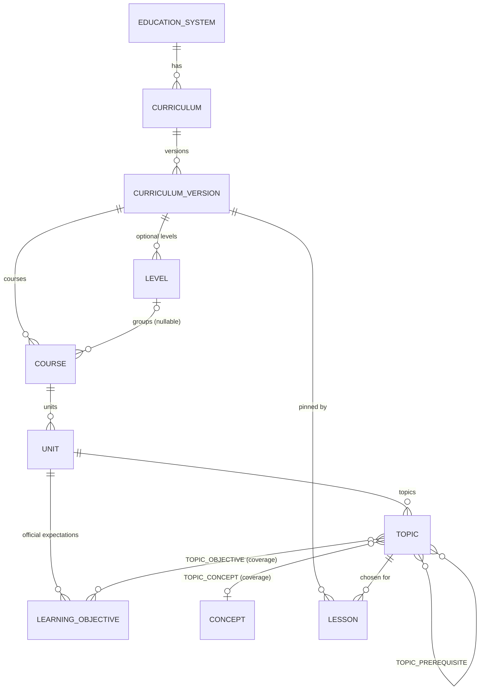

# 课程域架构(提案)

> 状态:**提案,待批准**。没有任何代码或迁移已创建。**数据集内容尚未核实**(见 [refactor-audit](refactor-audit.md) §6):本文只定义结构与规则,不含任何课程条目。
> 相关:[product-vision](product-vision.md) · [refactor-plan](refactor-plan.md) · [architecture](architecture.md)

## 1. 设计目标与刻意不做的事

**目标**:课程是一等概念;不同课程体系结构不同;选择级联由数据驱动;生成引擎使用所选课程与学习目标;LLM 不编造课程要求或对齐声明;支持版本与更新;主题不受支持时有清晰降级;不为尚未支持的课程过度设计。

**刻意不做(MVP)**:不建通用图/EAV(用有类型的表与外键,完整性由数据库保证);不建评分标准、考试权重、命令词、跨学科关联;不建多语言;不为"考试局规范"建专门层级——**每个具体规范(如某考试局的某一版规范)就是一个独立的 Curriculum**;不建课程数据的在线编辑后台(数据集是仓库里的文件)。

## 2. 核心洞察:课程主题 ≠ 引擎能力

一个**概念(Concept)**是与课程无关、面向引擎的规范单位(例如 `linear-equations-one-variable`),**生成器与验证器挂在概念上**。各课程的**主题(Topic)通过映射指向概念**。这样同一个已验证的引擎能服务多个课程体系,而"可选主题 = 数据集里的主题 ∩ 我们有验证能力的概念"。



## 3. 实体与字段

均为**公共只读数据**(无 owner):运行时角色只有 `SELECT`,写入仅由迁移/数据集加载器(owner 角色)完成;启用 RLS,`anon`/`authenticated` 无权限。主键是**稳定的文本 ID**(可读、可在数据集文件与测试里引用、跨环境一致)。

| 实体 | 关键字段 | 说明 / 约束 |
|---|---|---|
| **EducationSystem** | `id`、`name`、`regionCode` | 例如 Ontario(CA-ON)、美国(多州)、College Board、IBO、英国(England)。仅作分组与展示,轻量 |
| **Curriculum** | `id`(`ontario-math`)、`educationSystemId`、`subject`(`math`)、`name` | 一个"课程体系/规范"。不同体系在这里分开(包括同一管辖区的不同考试局规范) |
| **CurriculumVersion** | `id`(`ontario-math@2021`)、`curriculumId`、`label`、`effectiveFrom`、`status`(draft/published/superseded/withdrawn)、`sourceTitle`、`sourceUrl`、`sourcePublisher`、`sourceRetrievedAt`、`licenseNote`、`datasetHash`、`supersedesVersionId?` | **published 后不可变**(触发器);更新 = 新版本。`licenseNote` 与来源信息是**必填** |
| **Level**(可选) | `id`、`versionId`、`label`(Grade 9)、`kind`(grade/stage/…)、`ordinal` | AP、IB 没有就不建。`Course.levelId` 可空 |
| **Course** | `id`、`versionId`、`levelId?`、`code`(MTH1W / AP-CALC-AB)、`title`、`ordinal` | 选择流程里的"课程";IB 的 SL/HL 是两个 Course |
| **Unit** | `id`、`courseId`、`code?`(strand C)、`title`、`ordinal` | 官方的"单元/板块/strand" |
| **Topic** | `id`、`unitId`、`title`、`summary`(**自己的释义**,≤200 字)、`ordinal` | **可被选中去备课的最小单位** |
| **LearningObjective** | `id`、`unitId`、`officialCode`(C2.1)、`label`(**自己的释义**,≤200 字)、`sourceRef`、`sourcePage` | 官方条目;每条必须带**来源引用** |
| TopicObjective | `topicId`、`objectiveId`、`coverage`(full/partial)、`note?` | 主题覆盖哪些官方条目;`partial` 时 `note` 说明**未覆盖**什么(用于诚实的对齐声明) |
| **TopicPrerequisite** | `topicId`、`prerequisiteTopicId`、`note?` | 先备知识 = 同一数据集内的主题边;课包的 Prerequisites 段由它渲染 |
| **Concept** | `id`(`linear-equations-one-variable`)、`name`、`capabilityKey` | 面向引擎。`capabilityKey` 指向**代码里的能力注册表**(生成器、验证器及其版本、支持的形式/难度) |
| **TopicConcept** | `topicId`、`conceptId`、`coverage`(full/partial)、`supported` 派生自注册表、`note?` | "主题↔课程映射"的核心。无记录 = 主题存在但暂不支持生成 |
| **Lesson**(已有表,**加列**) | `curriculumVersionId?`、`topicId?`、`objectiveIds?`、`requestVersion`(默认 1) | 旧课包这些列为空;外键 `RESTRICT`,published 数据不会被删 |

**命名与 ID 方案**:`<curriculumId>@<versionLabel>` 为版本;其下 `/级别/课程/单元/主题` 用**数据集作者指定的稳定 slug**(一旦发布不改)。例如 `ontario-math@2021/mth1w/c/solving-linear-equations`(仅示意,**不是已核实的条目**)。

## 4. 数据集:文件为事实来源,数据库是它的投影

```
data/curricula/<curriculumId>/<versionLabel>/
    dataset.json        # 版本元数据、来源与授权
    structure.json      # 级别/课程/单元/主题,含 ID 与顺序
    objectives.json     # 官方条目(释义 + 来源引用)
    mappings.json       # 主题↔条目、主题↔概念、先备知识
```

- 用 zod 严格校验;**加载器** `pnpm curriculum:load` 幂等:计算 `datasetHash`,只**新增**版本,绝不修改已发布版本。
- **CI 数据集校验**(随 PR 运行):ID 唯一且格式合法;引用完整(课程→版本、单元→课程、主题→单元、映射→主题/条目/概念);每个条目有 `sourceRef`;版本有 `sourceUrl`/`licenseNote`;文本长度上限(防止粘贴原文);`supported` 的主题其概念在能力注册表中有注册,且该能力的 fixtures 全部通过。
- **人工核对是必经环节**:每条转写由你或学科专家抽检并签字(记录在 `dataset.json` 的 `review` 字段:谁、何时、范围)。
- **合成测试数据集**:用于测试级联与"无级别"体系(AP/IB 形态),标记 `synthetic: true`,加载器在非测试环境**拒绝**加载。

## 5. 授权与文本策略

课程文本是受版权保护的出版物(见审计 §6)。因此:**存标识符 + 我们自己写的简短释义 + 指向官方来源的页码引用,不存原文**;长度上限由 CI 强制。是否需要获得授权才能在商业产品里呈现这些释义/编码,是**法律问题,待你或法务确认**。若需要原文,也只在授权明确之后另行评估。

## 6. 选择流程由数据驱动

某版本需要哪些步骤,由数据里**实际存在的层级**决定:

```ts
// 伪代码
steps(version) = [
  hasLevels(version) ? "level" : null,
  "course", "unit", "topic",
].filter(Boolean)

options(version, selection) -> {
  step: "level" | "course" | "unit" | "topic",
  options: [{ id, label, supported: boolean, unsupportedReason?: "no_verified_generator" | "partial_only" }]
}
```

- 选了上一步才出现下一步;**更改上一步会清除其后的选择**(测试覆盖)。
- 推荐**由 URL 驱动、服务端渲染**的向导(`/prepare?c=…&level=…&course=…`):不需要新的公共 API,不依赖客户端状态,可后退/刷新,易测试;客户端 JS 只做体验增强。
- `supported` 来自 TopicConcept 与能力注册表,**不由前端判断**。

## 7. 解析课程上下文与降级

`resolveCurriculumContext({ versionId, topicId, objectiveIds? })` 返回**不可变快照**(生成时的标签与来源,之后数据集更新也不影响已生成的课包):

```ts
CurriculumContext = {
  curriculum: { id, name, version: { id, label, source: { title, url, publisher, retrievedAt } } },
  level?, course, unit, topic: { id, title },
  objectives: [{ id, officialCode, label, coverage, note?, source: { ref, page } }],
  prerequisites: [{ topicId, title }],
  concept: { id, capability: { generatorVersion, validatorVersion, forms, difficulties } },
  contextHash,
}
```

| 情形 | 行为 |
|---|---|
| 版本或主题不存在 / 已撤回 | 拒绝,`CURRICULUM_NOT_FOUND`;界面回到选择 |
| 主题存在但**无验证能力** | 选择界面里灰显并说明原因;若被强行提交,服务端拒绝(`TOPIC_UNSUPPORTED`),**不生成未经验证的练习题**;可选:记录"我想要这个主题"(`topic_interest`,仅 profile + topic,不含个人信息;见决定 D-35) |
| 主题只被**部分**覆盖 | 允许生成,但**对齐声明必须如实**:渲染"部分对齐:练习覆盖 …,不含 …"(来自 `note`),不得声称完全覆盖 |
| 想要的主题根本不在数据集 | 提示"暂不支持";不开放自由文本主题(避免回到"LLM 想怎么编就怎么编") |
| 版本被新版本取代 | 新课包默认用最新 published;已生成的课包仍固定在原版本 |

## 8. 可追溯性规则(不变量)

1. 课包里**每一处**课程对齐信息都由代码从 `CurriculumContext` 渲染(体系、版本、课程、单元、条目编码、释义、来源引用),并带 `contextHash`。
2. LLM 的输出是**纯文字**,经检查**不得包含**课程名称、考试局名称、条目编码形态的字符串或"符合/对齐"一类声明;违规则拒绝该次输出(属于有界修复,不是静默过滤)。
3. 没有 `CurriculumContext` 的课包不渲染"对齐"区块,也不得出现对齐措辞。
4. 对齐可追溯性是**不变量**,用测试而非指标保证:对任一课包,渲染出的每个条目编码都能在其快照里找到,且快照里的每条都能在发布的数据集里找到。

## 9. 迁移与兼容(加法优先)

| 迁移 | 内容 | 对现有数据 | 回滚 |
|---|---|---|---|
| A(M1) | 新建 curriculum 系列表、触发器(published 不可变)、RLS 与授权 | **不触碰任何现有表** | 删除新表(此时无依赖数据) |
| B(M3) | `lesson` 增加可空列 `curriculum_version_id`、`topic_id`、`objective_ids`、`request_version` | 旧行保持为空/默认 1 | 删除这些可空列(未被旧代码使用) |
| C(M6,取决于计费决定) | `job_kind` 增加 `adjust`;调整预留相关触发器 | 追加枚举值 | **枚举值无法简单删除**:尽量推迟到确需时;或用迁移前快照恢复 |

所有迁移先在数据库副本上演练;`prisma migrate deploy` 仍只在受审批的工作流里对托管库执行。**没有任何破坏性迁移**;没有"重置"。旧的 v1 请求与旧课包(目前只有测试数据)在迁移期间继续可读。

## 10. 第一个数据集(建议,待决定 D-30)

- **候选**:Ontario Grade 9 数学(MTH1W),因为你把它列在首位、属于中学、层级清晰(年级→课程→板块→条目)。**阻塞**:官方正文我无法抓取(JavaScript 站点),需要你提供官方 PDF 或确认来源。备选:美国 Common Core 的高中代数(如 HSA-REI 相关标准)——授权措辞需法务确认,且不是年级体系。
- **主题范围按引擎能力裁剪**:目前内核只能验证 `ax+b=c` 与 `ax+b=cx+d`(含分数系数、无解/恒等式),**不含括号/分配律、分式方程、不等式**。因此第一批主题只会是"一元一次方程的求解"一类;若官方条目包含分配律,则映射为 `partial` 并如实标注。具体条目编码、措辞**待核实后才写入**。

## 11. 测试

课程映射:数据集 schema、引用完整性、稳定 ID 清单(黄金列表,变更需显式决定)、`partial` 必带 `note`、`supported` 与注册表一致、长度上限。级联选择:只返回所选体系的级别/课程/主题;换上一步会清空后续;合成"无级别"数据集会跳过级别步骤;不受支持的主题灰显且服务端拒绝。上下文到达生成引擎:断言 worker 对 LLM 的请求输入包含目标 ID/释义与概念 ID,生成器收到概念能力;相同输入得到相同快照与 `contextHash`。可追溯性:渲染的对齐文本逐字等于由数据集派生的字符串;LLM 输出含课程声明时被拒绝(含提示注入风格的样本)。
