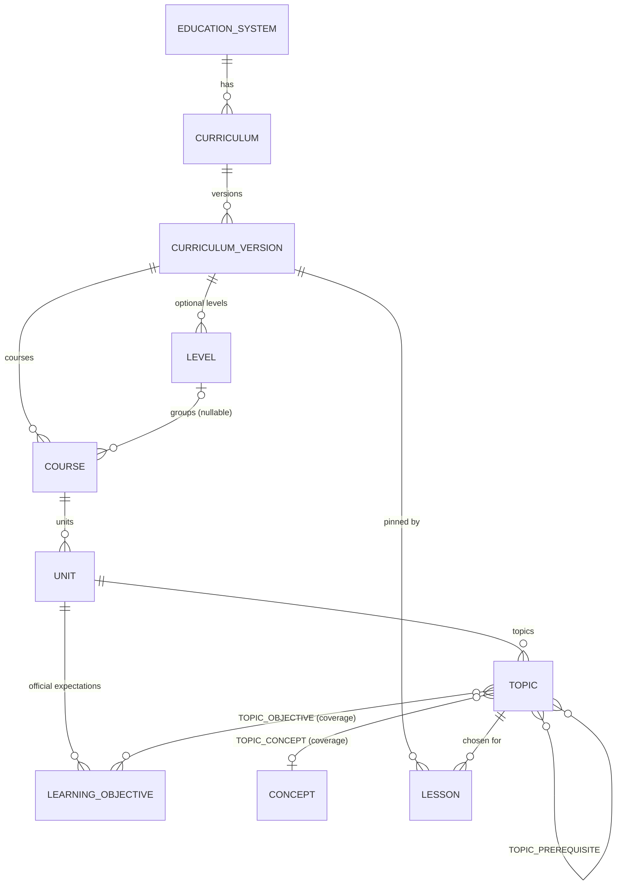

# 课程域架构(提案)

> 状态:**提案;相关决定已批准(D-30:MVP 目标 Ontario Grade 9,真实数据集是之后的独立里程碑 CM;D-36 授权推迟到 CM)。** 没有任何代码或迁移已创建。**数据集内容尚未核实**(见 [refactor-audit](refactor-audit.md) §6):本文只定义结构与规则,不含任何课程条目。
> 相关:[product-vision](product-vision.md) · [refactor-plan](refactor-plan.md) · [architecture](architecture.md)

## 1. 设计目标与刻意不做的事

**目标**:课程是一等概念;不同课程体系结构不同;选择级联由数据驱动;生成引擎使用所选课程与学习目标;LLM 不编造课程要求或对齐声明;支持版本与更新;主题不受支持时有清晰降级;不为尚未支持的课程过度设计。

**刻意不做(MVP)**:不建通用图/EAV(用有类型的表与外键,完整性由数据库保证);不建评分标准、考试权重、命令词、跨学科关联;不建多语言;不为"考试局规范"建专门层级——**每个具体规范(如某考试局的某一版规范)就是一个独立的 Curriculum**;不建课程数据的在线编辑后台(数据集是仓库里的文件)。

## 2. 核心洞察:课程主题 ≠ 引擎能力

一个**概念(Concept)**是与课程无关、面向引擎的规范单位(例如 `linear-equations-one-variable`),**生成器与验证器挂在概念上**。各课程的**主题(Topic)通过映射指向概念**。这样同一个已验证的引擎能服务多个课程体系,而"可选主题 = 数据集里的主题 ∩ 我们有验证能力的概念"。



## 3. 实体与字段

均为**公共只读数据**(无 owner):运行时角色只有 `SELECT`,写入仅由迁移/数据集加载器(owner 角色)完成;启用 RLS,`anon`/`authenticated` 无权限。主键是**稳定的文本 ID**(可读、可在数据集文件与测试里引用、跨环境一致)。

| 实体 | 关键字段 | 说明 / 约束 |
|---|---|---|
| **EducationSystem** | `id`、`name`、`regionCode` | 例如 Ontario(CA-ON)、美国(多州)、College Board、IBO、英国(England)。仅作分组与展示,轻量 |
| **Curriculum** | `id`(`ontario-math`)、`educationSystemId`、`subject`(`math`)、`name` | 一个"课程体系/规范"。不同体系在这里分开(包括同一管辖区的不同考试局规范) |
| **CurriculumVersion** | `id`(`ontario-math@2021`)、`curriculumId`、`label`、`effectiveFrom`、`status`(draft/published/superseded/withdrawn)、`sourceTitle`、`sourceUrl`、`sourcePublisher`、`sourceRetrievedAt`、`licenseNote`、`datasetHash`、`supersedesVersionId?` | **published 后不可变**(触发器);更新 = 新版本。`licenseNote` 与来源信息是**必填** |
| **Level**(可选) | `id`、`versionId`、`label`(Grade 9)、`kind`(grade/stage/…)、`ordinal` | AP、IB 没有就不建。`Course.levelId` 可空 |
| **Course** | `id`、`versionId`、`levelId?`、`code`(MTH1W / AP-CALC-AB)、`title`、`ordinal` | 选择流程里的"课程";IB 的 SL/HL 是两个 Course |
| **Unit** | `id`、`courseId`、`code?`(strand C)、`title`、`ordinal` | 官方的"单元/板块/strand" |
| **Topic** | `id`、`unitId`、`title`、`summary`(**自己的释义**,≤200 字)、`ordinal` | **可被选中去备课的最小单位** |
| **LearningObjective** | `id`、`unitId`、`officialCode`(C2.1)、`label`(**自己的释义**,≤200 字)、`sourceRef`、`sourcePage` | 官方条目;每条必须带**来源引用** |
| TopicObjective | `topicId`、`objectiveId`、`coverage`(full/partial)、`note?` | 主题覆盖哪些官方条目;`partial` 时 `note` 说明**未覆盖**什么(用于诚实的对齐声明) |
| **TopicPrerequisite** | `topicId`、`prerequisiteTopicId`、`note?` | 先备知识 = 同一数据集内的主题边;课包的 Prerequisites 段由它渲染 |
| **Concept** | `id`(`linear-equations-one-variable`)、`name`、`capabilityKey` | 面向引擎。`capabilityKey` 指向**代码里的能力注册表**(生成器、验证器及其版本、支持的形式/难度) |
| **TopicConcept** | `topicId`、`conceptId`、`coverage`(full/partial)、`supported` 派生自注册表、`note?` | "主题↔课程映射"的核心。无记录 = 主题存在但暂不支持生成 |
| **Lesson**(已有表,**加列**) | `curriculumVersionId?`、`topicId?`、`objectiveIds?`、`requestVersion`(默认 1) | 旧课包这些列为空;外键 `RESTRICT`,published 数据不会被删 |

**命名与 ID 方案**:`<curriculumId>@<versionLabel>` 为版本;其下 `/级别/课程/单元/主题` 用**数据集作者指定的稳定 slug**(一旦发布不改)。例如 `ontario-math@2021/mth1w/c/solving-linear-equations`(仅示意,**不是已核实的条目**)。

## 4. 数据集:文件为事实来源,数据库是它的投影

```
data/curricula/<curriculumId>/<versionLabel>/
    dataset.json        # 版本元数据、来源与授权
    structure.json      # 级别/课程/单元/主题,含 ID 与顺序
    objectives.json     # 官方条目(释义 + 来源引用)
    mappings.json       # 主题↔条目、主题↔概念、先备知识
```

- 用 zod 严格校验;**加载器** `pnpm curriculum:load` 幂等:计算 `datasetHash`,只**新增**版本,绝不修改已发布版本。
- **CI 数据集校验**(随 PR 运行):ID 唯一且格式合法;引用完整(课程→版本、单元→课程、主题→单元、映射→主题/条目/概念);每个条目有 `sourceRef`;版本有 `sourceUrl`/`licenseNote`;文本长度上限(防止粘贴原文);`supported` 的主题其概念在能力注册表中有注册,且该能力的 fixtures 全部通过。
- **人工核对是必经环节**:每条转写由你或学科专家抽检并签字(记录在 `dataset.json` 的 `review` 字段:谁、何时、范围)。
- **合成测试数据集**:用于测试级联与"无级别"体系(AP/IB 形态),标记 `synthetic: true`,加载器在非测试环境**拒绝**加载。
- **示例数据集**(D-30,CM 之前使用):标记 `sample: true`,**仅在开发/staging 由环境开关允许,生产加载器拒绝(`CURRICULUM_TARGET_ENV=production` 时加载脚本拒绝 `--allow-sample`,`--allow-sample` 必须显式设置 `CURRICULUM_TARGET_ENV` 为 staging 或 development,未设置同样拒绝)**;界面标注"示例,非真实课程";使用它生成的课包**不渲染任何对齐声明**(可追溯性不变量不被削弱)。

## 5. 授权与文本策略

课程文本是受版权保护的出版物(见审计 §6)。因此:**存标识符 + 我们自己写的简短释义 + 指向官方来源的页码引用,不存原文**;长度上限由 CI 强制。是否需要获得授权才能在商业产品里呈现这些释义/编码,是**法律问题,待你或法务确认**。若需要原文,也只在授权明确之后另行评估。

## 6. 选择流程由数据驱动

某版本需要哪些步骤,由数据里**实际存在的层级**决定:

```ts
// 伪代码
steps(version) = [
  hasLevels(version) ? "level" : null,
  "course", "unit", "topic",
].filter(Boolean)

options(version, selection) -> {
  step: "level" | "course" | "unit" | "topic",
  options: [{ id, label, supported: boolean, unsupportedReason?: "no_verified_generator" | "partial_only" }]
}
```

- 选了上一步才出现下一步;**更改上一步会清除其后的选择**(测试覆盖)。
- 推荐**由 URL 驱动、服务端渲染**的向导(`/prepare?c=…&level=…&course=…`):不需要新的公共 API,不依赖客户端状态,可后退/刷新,易测试;客户端 JS 只做体验增强。
- `supported` 来自 TopicConcept 与能力注册表,**不由前端判断**。

## 7. 解析课程上下文与降级

`resolveCurriculumContext({ versionId, topicId, objectiveIds? })` 返回**不可变快照**(生成时的标签与来源,之后数据集更新也不影响已生成的课包):

```ts
CurriculumContext = {
  curriculum: { id, name, version: { id, label, source: { title, url, publisher, retrievedAt } } },
  level?, course, unit, topic: { id, title },
  objectives: [{ id, officialCode, label, coverage, note?, source: { ref, page } }],
  prerequisites: [{ topicId, title }],
  concept: { id, capability: { generatorVersion, validatorVersion, forms, difficulties } },
  contextHash,
}
```

| 情形 | 行为 |
|---|---|
| 版本或主题不存在 / 已撤回 | 拒绝,`CURRICULUM_NOT_FOUND`;界面回到选择 |
| 主题存在但**无验证能力** | 选择界面里灰显并说明原因;若被强行提交,服务端拒绝(`TOPIC_UNSUPPORTED`),**不生成未经验证的练习题**;可选:记录"我想要这个主题"(`topic_interest`,仅 profile + topic,不含个人信息;见决定 D-35) |
| 主题只被**部分**覆盖 | 允许生成,但**对齐声明必须如实**:渲染"部分对齐:练习覆盖 …,不含 …"(来自 `note`),不得声称完全覆盖 |
| 想要的主题根本不在数据集 | 提示"暂不支持";不开放自由文本主题(避免回到"LLM 想怎么编就怎么编") |
| 版本被新版本取代 | 新课包默认用最新 published;已生成的课包仍固定在原版本 |

## 8. 可追溯性规则(不变量)

1. 课包里**每一处**课程对齐信息都由代码从 `CurriculumContext` 渲染(体系、版本、课程、单元、条目编码、释义、来源引用),并带 `contextHash`。
2. LLM 的输出是**纯文字**,经检查**不得包含**课程名称、考试局名称、条目编码形态的字符串或"符合/对齐"一类声明;违规则拒绝该次输出(属于有界修复,不是静默过滤)。
3. 没有 `CurriculumContext` 的课包不渲染"对齐"区块,也不得出现对齐措辞。
4. 对齐可追溯性是**不变量**,用测试而非指标保证:对任一课包,渲染出的每个条目编码都能在其快照里找到,且快照里的每条都能在发布的数据集里找到。

## 9. 迁移与兼容(加法优先)

| 迁移 | 内容 | 对现有数据 | 回滚 |
|---|---|---|---|
| A(M1) | 新建 curriculum 系列表、触发器(published 不可变)、RLS 与授权 | **不触碰任何现有表** | 删除新表(此时无依赖数据) |
| B(M3) | `lesson` 增加可空列 `curriculum_version_id`、`topic_id`、`objective_ids`、`request_version` | 旧行保持为空/默认 1 | 删除这些可空列(未被旧代码使用) |
| C(M6,取决于计费决定) | `job_kind` 增加 `adjust`;调整预留相关触发器 | 追加枚举值 | **枚举值无法简单删除**:尽量推迟到确需时;或用迁移前快照恢复 |

所有迁移先在数据库副本上演练;`prisma migrate deploy` 仍只在受审批的工作流里对托管库执行。**没有任何破坏性迁移**;没有"重置"。旧的 v1 请求与旧课包(目前只有测试数据)在迁移期间继续可读。

## 10. 第一个数据集(D-30 已批准:Ontario Grade 9;真实数据在 CM 里程碑)

- **目标**:Ontario Grade 9 数学(MTH1W)(用户批准,D-30),层级清晰(年级→课程→板块→条目)。**真实数据集属于之后的独立里程碑 CM**:官方正文我无法抓取(JavaScript 站点),届时需要你提供官方 PDF 或确认来源,并同时做出 D-36 授权决定。在此之前只使用示例数据集。(备选曾考虑美国 Common Core 高中代数:授权措辞需法务确认,且不是年级体系——不在本次范围。)
- **主题范围按引擎能力裁剪**:目前内核只能验证 `ax+b=c` 与 `ax+b=cx+d`(含分数系数、无解/恒等式),**不含括号/分配律、分式方程、不等式**。因此第一批主题只会是"一元一次方程的求解"一类;若官方条目包含分配律,则映射为 `partial` 并如实标注。具体条目编码、措辞**待核实后才写入**。

## 11. 测试

课程映射:数据集 schema、引用完整性、稳定 ID 清单(黄金列表,变更需显式决定)、`partial` 必带 `note`、`supported` 与注册表一致、长度上限。级联选择:只返回所选体系的级别/课程/主题;换上一步会清空后续;合成"无级别"数据集会跳过级别步骤;不受支持的主题灰显且服务端拒绝。上下文到达生成引擎:断言 worker 对 LLM 的请求输入包含目标 ID/释义与概念 ID,生成器收到概念能力;相同输入得到相同快照与 `contextHash`。可追溯性:渲染的对齐文本逐字等于由数据集派生的字符串;LLM 输出含课程声明时被拒绝(含提示注入风格的样本)。

## 12. M1 实现记录(2026-10-19)

M1 已按上述设计实现;与设计相比的差异与补充如下,均已落到代码、迁移与测试中。

| 项 | 实现 / 与设计的差异 |
|---|---|
| 表与约束 | 12 张表(`education_system`、`curriculum`、`curriculum_version`、`curriculum_level`、`curriculum_course`、`curriculum_unit`、`curriculum_topic`、`curriculum_objective`、`topic_objective`、`topic_prerequisite`、`concept`、`topic_concept`)。子表**重复存 `version_id`**,用复合外键让整棵树留在同一版本;子表 ID 必须以版本 ID 为前缀(CHECK) |
| 课程序号 | **同一级别内唯一**(无级别时在整个版本内唯一),不是版本内全局唯一(验证器最初写成全局唯一,被 Grade 1/Grade 2 的夹具发现后改正) |
| 不可变性 | 触发器强制:已发布/被取代/已撤回的版本及其子行不可改;草稿可编辑、可删除;状态只向前:published→superseded→withdrawn;发布时必须有 `published_at` |
| 数据集种类 | `real / sample / synthetic`;`real` 必须有来源 URL、检索日期、人工核对记录(CHECK + 验证器);非 real 必须在版本标签与课程名里自称 sample/synthetic |
| 可见性 | DAL 只返回**已发布**版本;**被新版本取代的版本不再提供给新课包**(旧课包用快照,不受影响);示例/合成数据按环境开关控制,生产默认全部不可见 |
| 能力注册表 | 在代码里(`src/lib/curriculum/capabilities.ts`);`concept` 表与注册表必须**完全一致**(测试);新增概念 = 代码 + 通过的 fixtures + 一条迁移 |
| 验证器补充规则 | 除设计里列出的规则外,新增:同一版本内课程代码唯一、同一单元内官方编码唯一(都是数据库唯一约束),避免数据集通过验证却在加载中途失败 |
| 环境变量 | `CURRICULUM_ALLOW_SAMPLE`(`0`/`1`,默认 `0`,其他值报错);在 Vercel staging 设为 `1` 才能看到示例数据,**生产不要设置** |
| 尚未做 | 向托管库加载示例数据的审批工作流(M2 需要在 staging 演示时再加,方式与 `db-migrate.yml` 相同);选择界面(M2);真实数据集(CM) |

## 13. M2 实现记录(2026-10-19)

| 项 | 实现 / 与设计的差异 |
|---|---|
| 请求 | `LessonRequestV2` 严格模式(未知字段一律拒绝),无自由文本;`documents` 可选 1–3 份,**无论选几份都只算一次生成**(D-38);`templateId` 目前只能是 `classic`,`locale` 只能是 `en` |
| 钉住 | `lesson` 记录 `curriculum_version_id` + `topic_id` + `objective_ids`,输入快照(含带哈希的上下文)存在 `input_spec`;这些列与 `input_spec` 由触发器保证创建后不可变 |
| 幂等 | v2 请求的哈希版本号为 2;重放检查在解析课程上下文**之前**,因此课程版本之后被取代/撤回,旧请求的重试仍返回原任务 |
| 向导 | 状态全部在 URL(`v`、`level`、`course`、`unit`、`topic`);`getSelectionPath` 用与 `getSelectionOptions` 共用的链校验,不一致的组合显示友好提示而不是错误页 |
| 示例数据 | 页面强制显示"示例数据"横幅;`CURRICULUM_ALLOW_SAMPLE=1` 才能看到;**生产默认看不到任何课程** |
| 尚未做 | 向托管 staging 库加载示例数据的审批工作流(目前只有本地/CI 通过 `pnpm curriculum:load` 加载);因此 staging 上的 `/prepare` 在加载之前会显示"暂无课程";输出文档子集目前只是占位(M4 才有真实文档);D-35 的"想要此主题"记录未做 |

## 14. M3a 实现记录(2026-10-19)

| 项 | 实现 / 与设计的差异 |
|---|---|
| 块与节 | 块类型:paragraph、note、list、step_list、timing、writing_space、question、worked_example、solution、alignment。**每种节只允许所需的块**(用判别联合表达),因此练习卷在类型上不含答案。设计里的"math(questionId 引用)"实现为携带已验证题目数据的 `question`/`worked_example`/`solution` 块 |
| 时间 | 单独的 `timing` 块(数字放在结构里,文字块不含数字)。分配:讲解 15%、例题 25%、复习 10%、练习为余数;练习 3–12 道(每道约 5 分钟),例题 1–3 道(+1 道无解例题) |
| 依赖 | `from` 是上游:objectives→explanation、objectives→exercises、explanation→worked_examples、exercises→solutions(derives)。`dependentsOf` 是传递闭包,供 M5 使用 |
| 哈希 | `contentHash` = 规范 JSON(kind、title、blocks);`inputsHash` = 种类、参数(含 `contextHash`、本节分钟数)与上游 `contentHash`。验证器重算 `contentHash`;`inputsHash` 暂只校验格式 |
| 种子 | 用 lesson id:同一课的重试内容不变;重新生成整包是新 lesson ⇒ 新种子 |
| 作业失败 | 验证不是 `verified` ⇒ `validation_failed`,不重试(确定性构建,重试无意义),释放额度。v2 不调用模型,所以无需 LLM 预算,但仍受任务期限与速率限制约束 |
| 修订 | `schema_version = 2`;v1 的 `content_hash` 现在用规范 JSON 计算(只影响新写入的修订;旧修订的哈希是历史值,不再重算) |
| 尚未做 | 真实渲染(M4);LLM 叙述与更丰富的讲解(M3b);调整(M5) |

## 15. M3b 实现记录(2026-10-19)

| 项 | 实现 / 与设计的差异 |
|---|---|
| 范围 | 模型写 explanation、derivation、worked_examples 的引言、teaching_sequence、common_mistakes 五段纯文字;`objectives`/`prerequisites` 仍是数据集措辞原样,`exercises`/`solutions` 仍由生成器产出,`alignment` 仍由代码从数据集写出 |
| 来源标记 | 由模型写的节 `provenance = {method:"llm", promptVersion, model}`;`inputsHash` 含提示版本与模型,所以换模型或提示会使这些节的哈希变化,其余节的哈希不变 |
| 回退 | 回退到 M3a 模板文字;因此"模型只能改进文字,不能让课包变得不完整或未验证" |
| 与设计的差异 | 设计里的"提纲文字"没有单独的 LLM 步骤:提纲(时间预算)仍是确定性的;"有界修复"= 一次带规则代码的重试 |
| 验证 | 模型文字经过两道检查:进入课包前的 `checkProseDraft`,和课包整体的 `validatePackage`(不依赖前者) |
| 旧表单 | 旧的 `/lessons/new`(请求 v1)用的占位提示只适合假提供方;用真实模型时它的每次调用都失败(`llm_invalid_output`),所以真实提供方下 v1 改为直接使用教师输入的目标、不调用模型(`legacyProse`)。M7 会删除旧表单 |
| 真实评估 | 已用真实服务评估(见 decisions.md §8.1):请求/响应形状与官方文档一致,结构化输出可用;评估暴露了长度上限过紧(400→600)与一条误报规则(单独的 `prompt`)并已修复。`thinking`/`effort` 参数仍未设置(使用模型默认),输出 token 约为稿子长度的 2.5 倍,说明思考占了大头;成本成为问题时再按模型关闭或降低 |

## 16. M4 实现记录(2026-10-19)

| 项 | 实现 / 与设计的差异 |
|---|---|
| 编译器接口 | 新增 `DocumentCompiler`(三份文档,要么全成功要么全失败);旧的两版 `Compiler` 只留给占位的 v1 作业。`SkeletonDocumentCompiler` 是本地/CI 的占位实现,生产被 worker 配置拒绝 |
| 模板 | `classic/1`:Letter、11pt、`lmodern` + T1、`amsmath`、`geometry`、`fancyhdr`;**不加载** `hyperref`、`enumitem`、`lastpage` 等;PDF 对象压缩关闭(`\pdfobjcompresslevel=0`) |
| 文字字符集 | 拉丁字母(含带音符)与常见标点;其他字符(表情、其他文字)打印为 `?`;这是**对非拉丁语言的限制**,与 D-39(只做英文)一致,将来加语言需要换字体与转义表 |
| 活动内容 | 比设计里"沙箱内检查"更靠外一层:宿主在容器之外检查 PDF(对象流 + 危险字典名扫描,先剔除二进制流以免误报);**不解析 PDF 结构** |
| TeX 配置 | `shell_escape=f`、`openout_any=p`、`openin_any=p` 经 Debian 的 `texmf.d` + `update-texmf` 生效(第一版直接写 `web2c/texmf-local.cnf` 没有被读取,是真实镜像上的测试发现的);**仍不把它们当安全边界**,边界是容器 |
| `p` 模式的效果 | 实测:`\openout` 即使写 `out/` 子目录也被拒绝,所以恶意 TeX 连往输出目录塞额外文件都做不到;宿主的文件白名单是第二层 |
| 可复现 | `SOURCE_DATE_EPOCH` + `FORCE_SOURCE_DATE=1`,同一源码两次编译的 PDF 逐字节相同(有测试) |
| 版面发现 | 练习与其书写空间用 `samepage` 仍会被拆页(实际编译并看图才发现),改为 `minipage` |
| 镜像 | 基础镜像摘要固定;TeX 包版本在 `packages.lock`(不含 `libc6`/`perl-base`,避免例行安全更新让 CI 无故变红);**生产镜像必须用摘要引用**(worker 配置强制) |
| 尚未做 | gVisor/Firecracker 的评估与目标主机验证(D-03/D-20);孤儿对象清理(P3);把 `CompileError.detail` 写进作业记录;视觉回归(版面度量)——目前只验证页数与文字;真实课程数据下的字体/符号覆盖 |

