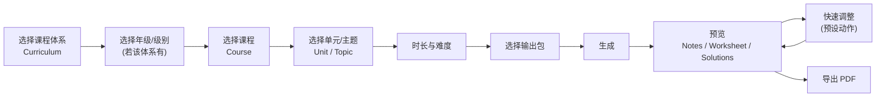

# 产品愿景(2026-10-19 更新)

> 状态:**提案,待用户批准**。本文件描述新的产品方向并与现有 [product.md](product.md) 对账;批准前不改动任何既有文档、`CLAUDE.md` 或代码。
> 相关:[refactor-audit](refactor-audit.md) · [curriculum-architecture](curriculum-architecture.md) · [refactor-plan](refactor-plan.md)

## 1. 一句话

**NotePrep:面向私人 STEM 辅导老师的备课自动化。** 核心承诺:"选择你要辅导的内容,几分钟内得到一套完整、排版专业的课包。" 首个学科:中学数学。

用户是**独立的私人辅导老师**,不是学校课堂老师。成功的体验是:几乎不用"写"东西,主要动作是**选择、预览、微调、导出**。

## 2. 不是什么

不是 Word 的替代品;不是 LaTeX 编辑器;不是通用富文本编辑器;不是班级管理系统(LMS);不是面向学生的 AI 家教。LaTeX 完全在幕后:老师**永远不需要**写 LaTeX、看懂 `.tex`、处理编译错误或手动调整分页。

## 3. 主流程(选择优先)

- 步骤 2、3 的**可用性取决于所选课程体系**:AP 与 IB 没有常规的年级层级,界面按数据里实际存在的层级自动跳过(见 [curriculum-architecture](curriculum-architecture.md) §3)。
- 课程体系、课程、主题**全部来自结构化的、有来源的数据集**,不由前端硬编码,也不由 LLM 编造。
- 目标课程体系(AP、IB、英国 GCSE/A-Level、美国 Common Core、Ontario)只是**目标**,不是许可去编造课程规范:MVP 只做**一个**经核实的小数据集。

## 4. 输出:课包

| 文档 | 内容 | 与旧产品的对应 |
|---|---|---|
| **Tutor Lesson Notes**(教师讲义) | 学习目标、概念讲解、公式与推导、例题(含解答)、教学顺序 | 旧"教师答案版"的讲义部分 |
| **Student Practice Worksheet**(学生练习) | 与课程对齐的练习、难度递进、留有书写空间;**不含答案** | 旧"学生版" |
| **Solutions / Answer Key**(答案与解答) | 经验证的最终答案、逐步解答,与练习一一对应 | 旧"教师答案版"的答案部分 |

规范数据源是**经模式校验的结构化内容**,不是 LaTeX。`.tex` 与 PDF 是某个修订版本的派生物,服务端保留结构化内容,以便**不必重新调用 LLM 就能重新渲染**。

## 5. 预览 + 调整,取代编辑器

结果页就是"生成的课包":三份文档的预览与导出。预设的快速调整:更容易、更难、增加例题、增加练习题、减少理论、展开分步解答、聚焦某个课程目标、更改课时。调整**只重新生成受影响的部分**,并一致地重新生成其依赖内容(例如练习改变则解答必须随之重新生成)。另提供**极小的手动更正**(只改文字,不改数学),用来修生成的错误,而不是把产品变回富文本编辑器。

## 6. 课程对齐:可追溯,不编造

- 所有"与某课程体系对齐"的声明都必须能追溯到**所选的、受支持的课程数据**(体系、版本、条目编码、来源引用)。
- 对齐信息由**代码**从数据集渲染,**LLM 的输出不得包含课程编码或对齐声明**(提示词之外还有输出检查)。
- 主题不在数据集中:给出清晰的降级路径(见 [curriculum-architecture](curriculum-architecture.md) §7),不用 LLM 凭空生成"看起来对齐"的内容。
- 数据集中有但我们**没有验证能力**的主题,同样标为"暂不支持",不生成未经验证的练习题(沿用 CLAUDE.md:"仅扩展到有验证覆盖的主题")。

## 7. 输入模式路线图

| 模式 | 状态 |
|---|---|
| A. 课程体系/主题选择 | **MVP 优先** |
| B. 上传已有材料 | 之后(需先评估版权、隐私、保留期) |
| C. 基于学生薄弱点的准备 | 之后(MVP 不收集学生个人信息) |
| D. 自动准备下一节课 | 之后 |

## 8. 与既有产品定义的差异(需要用户确认)

| 方面 | 既有定义([product.md](product.md)、CLAUDE.md) | 新愿景 |
|---|---|---|
| 输入 | 自由填写主题/程度/目标/题量/备注 | 选择:课程体系→级别→课程→主题,再选时长/难度/输出包 |
| 输出 | 学生版 + 教师答案版,各 `.tex` + PDF(4 个文件) | Notes + Worksheet + Solutions 三份 PDF(`.tex` 为内部派生物) |
| 编辑 | "受限内容编辑器";导出的 `.tex` 可自由编辑 | 预览 + 预设调整 + 极小的文字更正;`.tex` 不面向老师 |
| 部分 AI 重写 | CLAUDE.md:"推迟,直到计费语义明确" | 核心功能(M6),**计费语义需要先决定**(见 [refactor-plan](refactor-plan.md) §决策) |
| 课程对齐 | "没有证据不得声称对齐" | 允许且鼓励,但必须由数据集追溯(与旧规则一致,只是有了数据来源) |
| 主题范围 | 先打通一元一次方程 | 仍以验证覆盖为界:可选主题 = 课程数据集 ∩ 我们能验证的主题 |

不变的部分:一次完整生成才消耗额度、失败返还、幂等、围栏 token、Stripe 订阅语义、私有存储、沙箱隔离、数学验证优先——**这些是已建成的基础设施,不动**。

## 9. 完成的定义(Definition of Done)

一位私人数学辅导老师能:打开 NotePrep → 选择一个受支持的课程体系 → 选级别、课程、主题 → 选时长与难度 → 生成完整课包 → 预览 Notes/Worksheet/Solutions → 应用至少一个预设调整 → 导出专业的 PDF;**全程不输入 LaTeX、不手动排版**;所有课程对齐声明都能追溯到所选数据;现有应用在迁移期间保持可用。

## 10. 成功指标(增量)

沿用 [product.md](product.md) §7 的指标,新增(均无实际数据,不设阈值):选择流程完成率与耗时(从打开到点击生成)、"主题不受支持"的命中率与请求主题分布(决定下一步扩什么)、调整使用率与调整后导出率、每个课包的 LLM 成本(确定性部分不产生成本)、课程对齐声明的追溯完整率(应为 100%,是不变量而非指标)。
