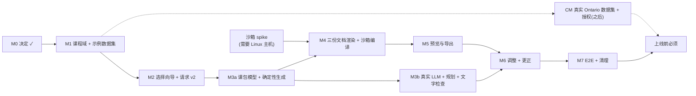

# 重构计划(提案)

> 状态:**关键决定已批准(2026-10-19):D-30(MVP 目标 Ontario Grade 9;真实数据集为之后的独立里程碑 CM)、D-31(不提供 `.tex`)、D-33(调整计费方案 B);D-36 推迟到 CM。** 既有文档与 `CLAUDE.md` 已按新方向对账。**里程碑 M1 尚未开始,等待用户的启动批准。**
> 相关:[product-vision](product-vision.md) · [refactor-audit](refactor-audit.md) · [curriculum-architecture](curriculum-architecture.md)

## 1. 原则

增量重构,不重写;保持现有应用**全程可用**(旧的 `/lessons/new` 流程在新流程通过验收之前一直保留);加法迁移,无破坏性变更,无数据库重置;沿用现有约定与依赖,**不新增依赖**(PDF 预览用浏览器原生查看器;不引入图/树库);额度、认证、worker 控制流、存储与沙箱设计**不动**。

## 2. 最小可行重构

1. **新增**课程域(表 + 数据集 + 加载器 + 能力注册表),不碰现有表。
2. **新增**选择向导 `/prepare` 与请求 v2;旧表单继续工作。
3. **新增**课包内容模型 `lesson-package/1`(分节、依赖、逐节哈希);先用**已有的确定性生成器**产出练习、解答与例题,再用模板化叙述补文字——这样**不需要 LLM 就能先打通一条完整路径**;LLM 之后只提升文字质量。
4. **新增**三份文档的渲染与真实沙箱编译,替换骨架编译器。
5. **新增**预览与导出页、预设调整与极小更正。
6. 最后退役旧表单、旧请求、骨架编译器,并对账文档与 CLAUDE.md。

## 3. 生成契约 v2

### 3.1 请求(服务端校验;无自由文本字段)

```ts
LessonRequestV2 = {
  requestVersion: 2,
  curriculum: { versionId: string, topicId: string },
  objectiveIds?: string[],              // 缺省 = 该主题映射的全部条目;必须是其子集
  durationMinutes: number,              // 15–180
  difficulty: "basic" | "mixed" | "challenge",
  documents: ("notes" | "worksheet" | "solutions")[],   // 缺省 = 全部三份;至少一份
  templateId: "classic",                // 初始只有一个模板
  locale: "en",
}
```

- 入队时在**同一个事务**里完成:幂等键 → 限流 → **解析课程上下文快照**(几次便宜的只读查询)→ 预留额度 → 建 job。解析失败**立即**返回给用户(不浪费一次排队),快照固定在 `lesson.input_spec`,worker 不再重新解析(保证版本固定)。
- 请求哈希带 `requestVersion`;v1 请求继续被接受,直到 M7。
- 不再提供自由文本"备注"(选择优先;需要时再作为带长度上限的可选项评估)。

### 3.2 流水线


阶段枚举保持 `generating / validating / compiling / storing` 不变("规划"并入 generating),**不改作业阶段枚举**;结算、租约、围栏、重试、预算沿用现有实现。

### 3.3 课包内容模型 `lesson-package/1`

```ts
Package = {
  schemaVersion: "lesson-package/1",
  request: LessonRequestV2, context: CurriculumContext /* 含 contextHash */,
  outline: { totalMinutes, sections: { id, kind, minutes, objectiveIds }[] },
  sections: Section[],
  documents: { id: "notes"|"worksheet"|"solutions", sectionIds: string[], templateId }[],
  deps: { from: SectionId, to: SectionId, kind: "derives" | "references" }[],
  validation: { math: LessonMathReport, prose: ProseCheckReport },
}
Section = {
  id, kind, title, blocks: Block[],
  provenance: { method: "deterministic" | "llm" | "tutor_edit", seed?, promptVersion?, generatorVersion? },
  inputsHash, contentHash, edited?: boolean,
}
kind ∈ objectives | prerequisites | explanation | derivation | worked_examples
     | teaching_sequence | common_mistakes | exercises | solutions | alignment
Block = paragraph | math(questionId 引用) | list | step_list | writing_space(lines) | note
```

- **规范数据源是 Package**;`.tex`/PDF 只是某个修订的派生物。**数学内容只通过题目引用(questionId)进入文档**,文字块里不出现数字与公式(沿用既有规则),因此叙述不可能与答案不一致。
- 文档由"节的组合"定义:**notes** = objectives + prerequisites + explanation + derivation + worked_examples + teaching_sequence + common_mistakes + alignment;**worksheet** = exercises(含书写空间)+ 简短 alignment,**类型上不包含 solutions**;**solutions** = solutions(逐步)+ 简短 alignment。
- 依赖边:`exercises → solutions`(`derives`:解答是练习的纯函数,**永远一起重生成**,不由 LLM 单独生成);`worked_examples → explanation`(`references`);`objectives`/`outline` 影响全部。
- `inputsHash` = 本节参数 + 上游节 `contentHash` 的哈希;`contentHash` = 本节规范内容的哈希。它们是"只重新生成受影响部分"与"调整不静默改动无关内容"的基础。
- 与现有数据库的关系:`lesson_revision.schema_version` 区分旧骨架内容(1)与 `lesson-package/1`;`artifact_manifest` 增加 `manifestVersion`(v2 = 三份文档;旧清单对旧修订继续有效);修订不可变的触发器**不需要改**。

### 3.4 产物清单 v2

`{ manifestVersion: 2, documents: [{ id: "notes"|"worksheet"|"solutions", pdf: {path, sha256, bytes, pages}, tex: {path, sha256, bytes} /* 仅内部 */ }] }`;路径 `{ownerId}/{lessonId}/{revisionId}/{attemptId}/{document}.{pdf|tex}`。完整生成 = 所请求的每份文档的 PDF 都已校验并提交(缺任何一份则整体不提交、释放额度,与现在一致)。

## 4. 预设调整与极小更正

### 4.1 调整动作 → 计划(纯函数,先算计划再执行)

`planAdjustment(package, action, params)` 返回 `{ changed, dependents, unchanged, method: 每节 deterministic|llm }`。

| 动作 | 受影响的节 | 方法 | 依赖(一并重生成) |
|---|---|---|---|
| 更容易 / 更难 | exercises(及可选一道例题)的难度 | **确定性**(生成器换难度,新种子) | solutions;outline 的题量/用时 |
| 增加例题 | worked_examples 追加 | 确定性(生成器)+ 模板叙述;LLM 叙述可选 | outline 用时 |
| 增加练习题 | exercises 追加 | 确定性 | solutions;outline |
| 减少理论讲解 | explanation / derivation | **LLM 重写**(更短)或确定性删减推导 | outline 用时 |
| 展开分步解答 | solutions 的步骤粒度 | 确定性(生成器的详细模式)+ 模板叙述 | 无(solutions 自身) |
| 聚焦某个课程目标 | outline 权重 + 相关节 | 确定性规划 + 受影响节再生成(LLM/确定性) | 与该目标相关的 exercises→solutions |
| 更改课时 | outline | 确定性重新规划,增删节 | 新增节生成,被删节移除 |

**大多数调整是确定性的**:不调用 LLM、几乎没有成本、可复现。只有"减少理论""聚焦目标"的文字部分需要 LLM。

### 4.2 执行与一致性

- 调整**创建新的草稿修订**(已发布修订不可变);**未受影响的节被原样复用**(内容与哈希逐字节相同)。
- 依赖由计划显式给出,而不是临时判断;`derives` 边永远传递闭包。
- 修订经重新验证、渲染、编译后才发布(与首次生成相同的提交规则)。
- 失败不改变原修订;调整可取消;幂等键与限流沿用。

### 4.3 极小手动更正

只允许改**文字字段**(标题、讲解段落、叙述、常见错误)。数学内容(题目、答案、步骤)**不可手改**:要改只能通过调整或重新生成(这样答案与解答永远一致)。更正创建新修订、标记该节 `edited`、`provenance.method="tutor_edit"`,经文字检查(无课程声明、无 HTML/URL/LaTeX 命令)后重新渲染。这不是富文本编辑器。

### 4.4 调整的计费(**需要你决定,见 D-33**)

| 方案 | 做法 | 评价 |
|---|---|---|
| A | 确定性调整免费(受速率与计算配额限制);不提供 LLM 调整 | 最简单,功能受限 |
| **B(推荐)** | 确定性调整免费;含 LLM 的调整消耗**每课包的调整额度**(可配置,默认值待定),与"生成次数"分开;全部受速率/成本上限约束 | 成本与体验平衡;不污染 3 次免费生成的语义 |
| C | 每次含 LLM 的调整算一次新的完整生成 | 语义最清楚,但会让用户不敢使用调整 |

无论选哪个,都沿用现有原则:**成功才消耗、失败返还、一次结算**。

## 5. 前端信息架构

| 路由 | 内容 | 状态 |
|---|---|---|
| `/` | 落地页;已登录显示"准备一节课" | 修改(M2) |
| `/prepare` | 选择向导:体系 → [级别] → 课程 → 单元/主题 → 时长与难度 → 输出包 → 复核 → 生成;**URL 驱动、服务端渲染** | **新增(M2)** |
| `/jobs/[id]` | 生成进度(阶段、重试、取消);成功后跳转课包页 | 保留,修改(M5) |
| `/lessons/[id]` | **课包页**:Notes / Worksheet / Solutions 标签页 + PDF 预览 + 导出 + 对齐信息 + 调整面板 + "更正"抽屉 | **新增(M5/M6)** |
| `/lessons` | 历史 + 剩余额度 | 保留 |
| `/lessons/new` | 旧自由表单 | **保留到 M7,之后退役**(重定向到 `/prepare`) |
| `/account`、`/login` | 不变 | 保留 |

组件:`SelectionWizard`、`StepOptions`(显示灰显与原因)、`PackageSummary`、`DocumentPreview`(`<iframe>`/`<object>` 加载短时签名 URL,失败时降级为下载链接)、`AdjustmentPanel`、`CorrectionDrawer`、`AlignmentPanel`。界面**不出现** LaTeX、`.tex` 或编译日志;失败信息是可操作的普通语言。

## 6. 里程碑

调整后的顺序与理由:在你建议的 M1–M7 之上,**增加 M0**(决定与数据来源,是外部阻塞)并把 **M3 拆成 M3a/M3b**——先用确定性部分跑通完整路径,再接 LLM。**沙箱 spike(P2-T6)应尽早并行启动**,因为它依赖一台 Linux 主机,是日历时间上最不确定的一环。



### M0 — 决定(已完成)
- **结果**:D-30(MVP 目标 Ontario Grade 9;**真实数据集是之后的独立里程碑 CM**)、D-31(不提供 `.tex`)、D-33(调整计费方案 B,调整额度默认值待定)已批准;D-36(课程文本授权)推迟到 CM;D-32、D-34 已由需求规定;D-35、D-37、D-38、D-39 为临时默认(见 [decisions](decisions.md) §7)。
- **含义**:课程的**基础设施**(模型、加载器、选择界面、上下文、渲染、调整)可以先做完,**不再被官方数据来源阻塞**;真实数据在 CM 到位。在 CM 之前,开发/staging 只使用**明确标注的示例数据集**,界面标注"示例,非真实课程",**不产生任何对齐声明**。
- **回滚**:不适用。

### M1 — 课程域模型与示例数据集(基础设施)
- **交付**:迁移 A(新表、触发器、RLS、授权);Prisma 模型;`src/lib/curriculum`(schema、加载器、只读 DAL、`getSelectionOptions`、`resolveCurriculumContext`);能力注册表(首个概念指向**现有**生成器与验证器);`data/curricula/` 结构;CI 数据集校验作业;**合成测试数据集**(含"无级别"形态)和一个**明确标注的示例数据集**(`sample: true`;仅在开发/staging 由环境开关允许,生产加载器拒绝)。**真实数据集不在 M1,见 CM。**
- **验收**:加载器幂等,已发布版本不可变(触发器测试);引用完整性与来源完整性校验通过;运行时角色只有 SELECT;`supported` 与注册表一致;**示例/合成数据集在生产环境被拒绝加载**,且使用它们的课包不渲染任何对齐声明(测试覆盖)。
- **测试**:数据集 schema/完整性/长度上限/稳定 ID 黄金清单;触发器与授权(真实 Postgres);能力注册表一致性;合成数据集的级联形态。
- **风险**:转写错误与授权(缓解:释义 + 引用 + 人工签字);数据集形态在第二个体系出现时需要调整(缓解:只做到有类型表、可空级别)。
- **依赖**:M0(已完成)。
- **回滚**:删除新表(此时无依赖数据);数据集文件可回退。

### M2 — 课程感知的级联选择界面与请求 v2
- **交付**:`/prepare` 向导(URL 驱动、服务端渲染);`LessonRequestV2` 校验;`createGeneration` 接受 v2(同一事务内解析上下文);迁移 B(`lesson` 可空列 + `request_version`);不受支持主题的灰显与服务端拒绝;旧 `/lessons/new` 保持工作。
- **验收**:只显示所选体系的级别/课程/主题;更改上一步清空后续;无级别体系跳过级别步骤;不受支持的主题不可提交且服务端拒绝;v2 与 v1 的幂等、额度、预留行为**完全一致**(既有集成测试不改动即通过);刷新与后退不丢失选择。
- **测试**:级联依赖单元/集成测试;Playwright:选择 → 生成(骨架)→ 状态;旧表单 E2E 保持通过;v1/v2 幂等冲突测试。
- **风险**:两套请求并存增加 DAL 分支(缓解:共用同一事务骨架,只在"解析输入"一步分叉)。
- **依赖**:M1。
- **回滚**:隐藏 `/prepare` 入口,保留旧流程;迁移 B 的列为可空,可删除。

### M3a — 课包内容模型与确定性生成
- **交付**:`lesson-package/1` 的 Zod schema 与类型;`buildPackage(context, request)`:确定性提纲(时间预算)、由生成器产出练习/解答/例题、模板化叙述、逐节哈希与依赖;集成到 worker 流水线(替换骨架内容;仍用假 LLM 与骨架渲染);数学验证接入整课报告;迁移:无(用 `schema_version`)。
- **验收**:一个 v2 作业端到端成功,内容为 `lesson-package/1` 且数学全部 verified;课程上下文快照存在于内容;worksheet 视图**类型上不含**解答;同一请求同一种子得到逐字节相同的内容;既有额度/任务集成测试**不改动**即通过。
- **测试**:schema;确定性与哈希稳定;文档视图组合(worksheet 无答案的类型与文本检查);依赖边正确;验证接入;**课程上下文到达生成引擎**(断言生成器收到概念能力与目标)。
- **风险**:分节模型过早僵化(缓解:只实现上面列出的节与块)。
- **依赖**:M2。
- **回滚**:流水线按 `request_version` 分支,可切回骨架内容。

### M3b — 真实 LLM 适配器、提纲文字与文字检查
- **交付**:第一个真实 LLM 适配器(默认 Anthropic,可配置;接口不变);讲解/叙述/常见错误的 LLM 节;**文字检查**(无课程声明/编码、无 URL/HTML/LaTeX 命令、不含数字公式);有界修复;成本与 token 记录;小型真实质量评估脚本(手动,不进 PR)。
- **验收**:对抗样本(含提示注入风格输出)被拒绝;LLM 请求输入含目标释义与概念 ID;预算/超时/重试按既有规则;一次受控评估记录(成本、失败率、人工抽查)。
- **测试**:契约测试(假与真共用);文字检查对抗用例;预算与错误分类;上下文到达 LLM。
- **风险**:文字质量与成本;模型输出违规率(缓解:有界修复 + 模板化回退)。
- **依赖**:M3a;LLM 密钥(你提供,仅 worker 持有)。
- **回滚**:切回模板化叙述(M3a 路径)。

### M4 — 后端三份文档渲染与沙箱编译
- **交付**:`renderPackage(package, documentId)` 纯函数 + 3 个固定模板(notes、worksheet 含书写空间、solutions);转义与受限数学渲染(数学由结构化引用**代码生成**);沙箱 runner 与镜像(固定版本);真实编译;清单 v2;替换骨架编译器;`pnpm test:latex`。
- **验收**:三份有效 PDF;worksheet 的 PDF 文本不含任何练习答案;同一修订两次渲染文本一致;沙箱**全部负面测试**通过(见 test-plan §6);失败路径释放额度。
- **测试**:渲染/转义/注入单元测试;真实镜像上的编译与负面测试;版面度量回归(页数、文本);清单完整性。
- **风险**:**最大不确定性**——沙箱主机与 gVisor 兼容;字体;书写空间版面(缓解:spike 先行,备选 Firecracker)。
- **依赖**:M3a;一台 Linux 主机(D-20);沙箱 spike。
- **回滚**:保留骨架路径(仅开发);生产不启用,直到验收。

### M5 — 课包预览与导出
- **交付**:`/lessons/[id]` 课包页;Supabase Storage 适配器(私有桶、服务端路径、短时签名 URL);标签页预览与下载;对齐信息面板;`/jobs/[id]` 成功后跳转。
- **验收**:仅所有者可见与下载;URL 到期后失效;预览与下载来自同一 `revisionId`;只提供 PDF(不提供 `.tex`,取决于 D-31);跨用户访问被拒。
- **测试**:E2E;跨用户矩阵;缓存头;Storage RLS(真实本地 Supabase)。
- **风险**:内嵌 PDF 在移动端兼容(缓解:降级为下载链接)。
- **依赖**:M4。
- **回滚**:隐藏页面入口;存储对象不受影响。

### M6 — 预设调整与极小更正
- **交付**:`planAdjustment` 纯函数与执行器;调整作业(迁移 C 与触发器,取决于 D-33);`AdjustmentPanel`、`CorrectionDrawer`;先做确定性动作,再做含 LLM 的动作。
- **验收**:**未受影响的节与调整前逐字节相同(哈希相等)**;依赖节被一致地重生成(解答随练习);调整失败不改变原修订且返还;数学内容不可手改;重复提交幂等;计费符合 D-33。
- **测试**:属性测试(任意调整后依赖一致、无关节哈希不变);失败/取消/预算;更正的文字检查;额度不变量沿用既有测试。
- **风险**:依赖规则复杂度;计费定义(缓解:先确定性后 LLM)。
- **依赖**:M5(以及 M3b 才能做 LLM 动作)。
- **回滚**:隐藏面板;迁移 C 仅追加。

### CM — 真实课程数据集与授权(之后的独立里程碑)
- **交付**:Ontario Grade 9 数学(MTH1W)的真实数据集:由你**提供官方来源**(官方 PDF/页面;我无法抓取官方站点),我据此逐条转写**释义 + 页码引用**(不存原文),按主题范围裁剪到我们能验证的内容(括号/分配律等未覆盖部分标为 `partial` 并如实标注);你或学科专家抽检签字;**D-36 授权决定**在此一并做出;加载为已发布版本;生产环境改为只加载真实数据集。
- **验收**:数据集通过全部 CI 校验;每个条目有官方来源引用;人工核对记录在案;D-36 已决定;生产环境中不再存在示例数据;课包的每个对齐声明追溯到该数据集。
- **测试**:数据集校验(沿用 M1);可追溯性测试对真实数据集运行;人工抽检记录。
- **风险**:官方来源获取、转写错误、授权结论(缓解:释义 + 引用 + 人工签字;授权由你/法务)。
- **依赖**:M1;你提供来源。**生产上线的前提**(在此之前只能用示例数据,不能宣称课程对齐)。
- **回滚**:发布新版本即可替换;已生成的课包固定在其原版本。

### M7 — 端到端与清理
- **交付**:完整"完成的定义"E2E;退役 `/lessons/new` 与 v1 请求、骨架编译器与 `ALLOW_FAKE_COMPILER`;对账既有文档与 `CLAUDE.md`;死代码清理;staging 演练。
- **验收**:§9 的场景在真实浏览器 + 真实沙箱 + (受控)真实 LLM 上通过;旧路径已移除且无死引用;文档与代码一致。
- **测试**:全量套件;staging 手动演练记录;人工数学抽查。
- **风险**:遗留引用;文档漂移。
- **依赖**:M5、M6。
- **回滚**:每次清理是独立提交,可逐个回退。

## 7. 迁移、兼容与回归风险

**数据**:今天**没有生产数据**(staging 只有测试账号;本地与 CI 数据库一次性)。尽管如此,所有迁移加法优先、先在副本演练、迁移仍只通过受审批的工作流执行;**没有重置,没有破坏性迁移**。迁移 C 的枚举追加不易回滚,故推迟到需要时。

| 风险 | 影响 | 缓解 |
|---|---|---|
| 清单形状变化 | `commitSuccess` 与清单校验、既有测试依赖 4 文件 | `manifestVersion` 并行支持两种形状;旧测试保持,直到 M7 才删 |
| 请求 v1/v2 并存 | DAL 分支、哈希冲突 | 共用事务骨架;`requestVersion` 入哈希;双向幂等测试 |
| 调整的计费 | 破坏额度不变量 | 先定 D-33;`adjust` 沿用"成功才结算、失败返还"并由触发器/约束保护 |
| 课程数据错误或授权问题 | 对齐声明错误或法律风险 | 释义 + 引用 + 人工签字;CI 校验;授权由你/法务确认 |
| LLM 越界(课程声明、数字) | 不可追溯的对齐、数学不一致 | 文字检查 + 有界修复;数学只经引用进入文档 |
| 沙箱主机不可用 | M4/M5 延期 | spike 提前;Firecracker 备选;骨架路径仅开发 |
| E2E 绑定旧表单 | 重构时测试大面积失败 | 旧流程测试保留至 M7;新流程测试并行新增 |
| CI 时间增长 | 反馈变慢 | 沙箱作业只在相关路径变化时运行;数据集校验很快 |
| 文档漂移 | 新旧文档矛盾 | 批准后做一次对账提交;M7 再核一遍 |

## 8. 需要你决定的事项

| ID | 问题 | 我的推荐 | 影响 |
|---|---|---|---|
| D-30 | **已批准**:MVP 目标 Ontario Grade 9;真实数据集是之后的独立里程碑 CM,届时由你提供官方 PDF/页面 | CM |
| D-31 | **已批准**:不向用户提供 `.tex`(只给 PDF);`.tex` 仅作内部派生物与调试 | CLAUDE.md §1/§7 需改 |
| D-32 | (需求已含)文档集合:Notes + Worksheet + Solutions 取代学生版/教师版? | 是;"完整生成"= 所请求文档的 PDF 全部成功 | 清单 v2、CLAUDE.md |
| D-33 | **已批准**:方案 B(见 §4.4);每课包 LLM 调整额度的默认值待定(配置值) | M6 与额度语义 |
| D-34 | (需求已含)手动更正范围 | 仅文字字段,不改数学 | M6 |
| D-35 | 不受支持主题的降级 | 灰显 + 原因;可选记录"想要此主题"(仅 profile+topic);不开放自由文本主题 | M2 |
| D-36 | **已推迟到 CM**:课程文本策略与授权 | 只存标识符 + 自己的释义 + 来源引用;是否需要授权由你/法务确认 | CM |
| D-37 | 旧 `/lessons/new` 的退役时间 | 新流程在 M3a 通过验收后隐藏入口,M7 删除 | M2、M7 |
| D-38 | 输出包可否选子集? | 可选(至少一份);无论选几份,都算**一次**生成 | M2、清单 |
| D-39 | 语言/地区 | 英文;不含法语(Ontario 有法语版本,暂不做) | M1 |

> 表中标"已批准"的是用户 2026-10-19 的明确答复;标"需求已含"的由你的需求说明规定;**其余(D-35、D-37、D-38、D-39)是我的推荐/临时默认,尚未经你确认**,到相关里程碑之前仍可更改。

## 9. 工作量估算

**假设与说明**:单个工程师 + AI 协作的**专注工作日**;只含工程工作,**不含**等待你的决定、官方数据来源、法务评估、主机采购;没有真实数据可校准,**这些是估计,不是承诺**,区间较宽,置信度低到中等。

| 里程碑 | 估计(专注工作日) | 主要不确定性 |
|---|---|---|
| M0 决定 | 已完成 | — |
| M1 课程域与示例数据集(基础设施) | 3–5 | 触发器/加载器/CI 校验的细节 |
| CM 真实 Ontario 数据集与授权(之后) | 2–4(我方工作)+ 外部:官方来源、核对签字、授权结论 | 官方来源获取与授权;**不在上述总和之外会影响上线日期** |
| M2 选择向导与请求 v2 | 3–5 | v1/v2 并存的细节 |
| M3a 课包模型与确定性生成 | 5–8 | 分节模型与依赖的取舍 |
| M3b 真实 LLM 与文字检查 | 5–8(+ 质量评估) | 模型文字质量与违规率 |
| M4 渲染与沙箱 | 8–15 | **沙箱主机/gVisor/字体**;最大不确定性 |
| M5 预览与导出 | 4–6 | 内嵌 PDF 兼容性、Storage 适配器 |
| M6 调整与更正 | 8–12 | 依赖规则、计费 |
| M7 E2E 与清理 | 3–5 | 遗留引用 |
| **合计** | **约 41–68**(中位约 54;含 CM 的我方工作) | M4 与 CM 的外部等待最影响日历时间 |

不含:Stripe 订阅(Phase 3)、孤儿对象清理与成本上限(P3)、隐私与上线前验证(P4)。

## 10. 当前状态与下一步

1. **已完成**:决定 D-30/31/33(D-36 推迟);既有文档与 `CLAUDE.md` 已对账(见 [refactor-audit](refactor-audit.md) §5 与对应提交)。
2. **等待你的批准**:启动 **M1**(课程域模型 + 示例数据集)。在你明确批准之前不开始。
3. **可并行的无风险事项**:准备一台 Linux 主机以便沙箱 spike(与课程工作无关,见 [staging-setup](staging-setup.md) §5)。
4. **待你之后提供**:调整额度的默认值(D-33);CM 阶段的官方课程来源与授权决定(D-36)。
